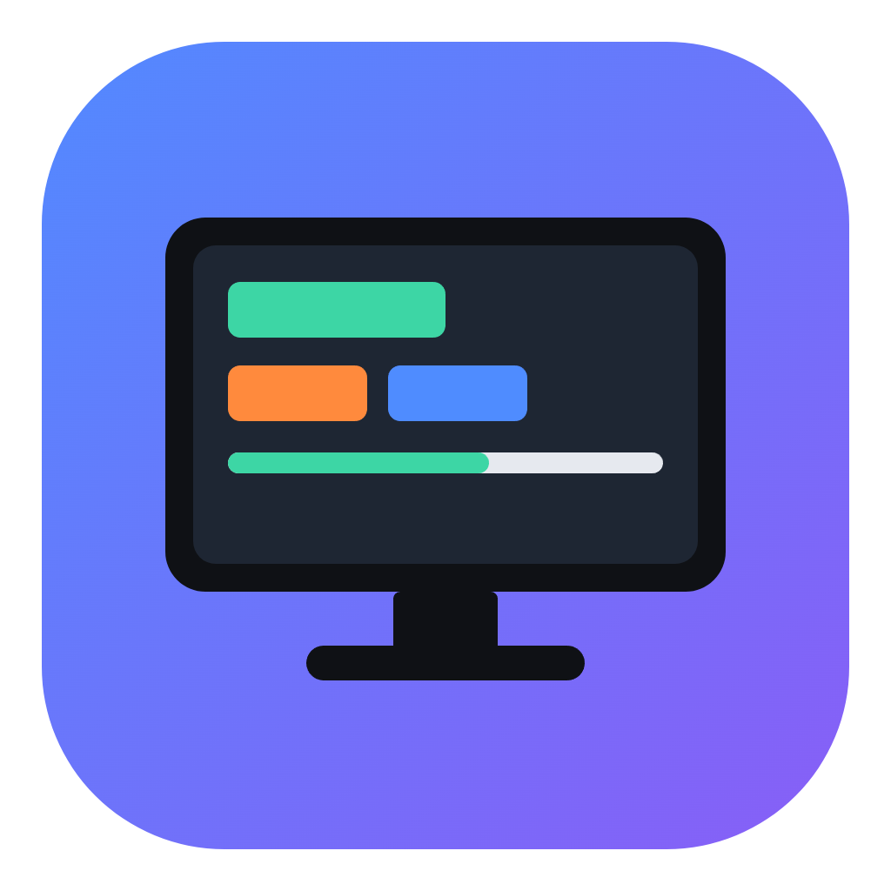
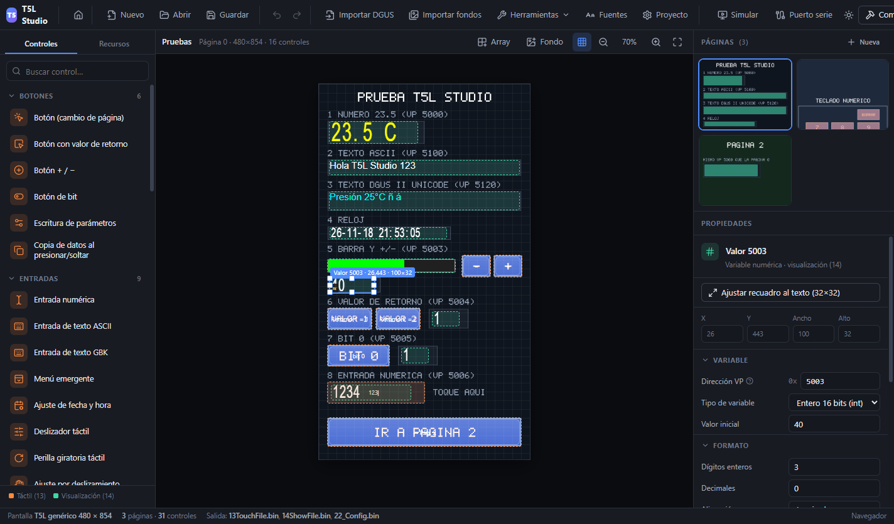
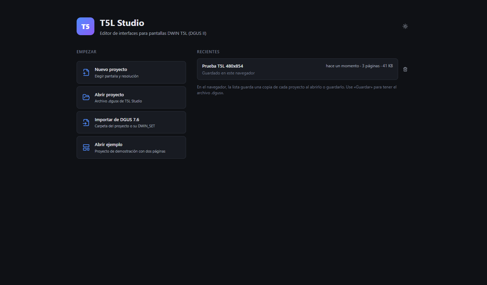
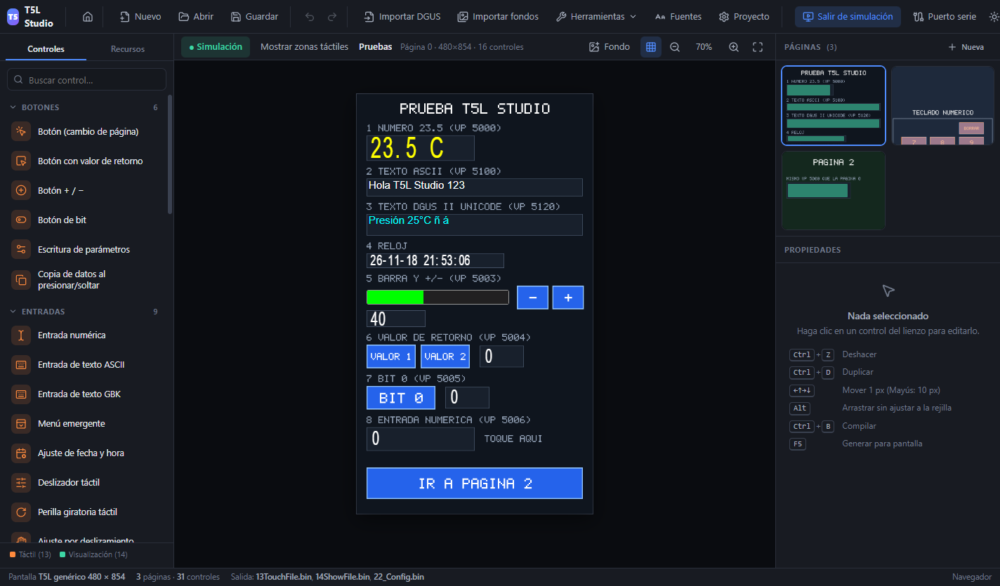

<div align="center">



# T5L Studio

**Editor moderno y abierto de interfaces para pantallas DWIN T5L (DGUS II).**<br>
Una alternativa a DGUS V7.6 con interfaz al estilo de Nextion Editor, que genera los mismos archivos byte a byte.

[](https://github.com/omarchavezq/t5l-studio/actions/workflows/ci.yml)
[](https://github.com/omarchavezq/t5l-studio/releases/latest)
[](#licencia)

[](https://omarchavezq.github.io/t5l-studio/)


[Descargar](https://github.com/omarchavezq/t5l-studio/releases/latest) ·
[Probar en el navegador](https://omarchavezq.github.io/t5l-studio/) ·
[Guía de uso](docs/USO.md) ·
[Formatos](docs/FORMATOS.md) ·
[Hoja de ruta](ROADMAP.md)



</div>

> [!IMPORTANT]
> **Beta.** La salida se comparó byte a byte con 10 proyectos reales hechos en DGUS V7.6, pero todavía **no se ha probado en una pantalla física** un proyecto creado desde cero. Antes de usarlo en producción, siga [docs/PRUEBAS_HARDWARE.md](docs/PRUEBAS_HARDWARE.md).

## Descargar

| Plataforma | Archivo |
|---|---|
| **Windows 10/11 (x64)** | `T5L-Studio-Setup-<versión>.exe` en [Releases](https://github.com/omarchavezq/t5l-studio/releases/latest) |
| **Navegador** (Chrome o Edge) | [omarchavezq.github.io/t5l-studio](https://omarchavezq.github.io/t5l-studio/), sin instalar |

El instalador **todavía no está firmado**. Windows SmartScreen mostrará «Windows protegió su PC»: pulse **Más información → Ejecutar de todas formas**. Compruebe antes que el archivo es el publicado:

```powershell
Get-FileHash .\T5L-Studio-Setup-0.3.0.exe -Algorithm SHA256
# compare el resultado con SHA256SUMS.txt de la misma versión
```

Descargue solo desde las [Releases de este repositorio](https://github.com/omarchavezq/t5l-studio/releases).

## Por qué T5L Studio

- **Interfaz de esta década.** Lienzo con zoom y rejilla, caja de herramientas con búsqueda, propiedades agrupadas, deshacer ilimitado, tema claro y oscuro, y pantalla de bienvenida con proyectos recientes.
- **Compatible de verdad.** Importa proyectos de DGUS V7.6 y vuelve a generar `13TouchFile.bin`, `14ShowFile.bin`, `22_Config.bin` y los `.icl` **idénticos byte a byte**.
- **Simulador integrado.** Toque botones, escriba valores y cambie de página sin cargar la tarjeta SD.
- **Todo en un solo lugar.** Generador de fuentes, ICL, configuración `T5LCFG.CFG`, teclados, Modbus/PLC, red, textos en varios idiomas, audio WAE y video a ICL, sin las herramientas sueltas de `TOOL/`.
- **Puerto serie.** Monitor de tramas, lectura y escritura de VP, y descarga por sectores con Web Serial.
- **Abierto y gratuito**, con licencia MIT o Apache-2.0.

## Qué funciona hoy

| Área | Estado |
|---|---|
| 48 controles de visualización y táctiles de DGUS II, más la perilla giratoria (`120.lib`) | ✅ |
| Importar proyectos de DGUS V7.6, incluidos nombres y tamaños desde los TFT | ✅ |
| Generar 13/14/22 e ICL idénticos a V7.6 | ✅ verificado con 10 proyectos |
| Simulador: botones, entradas, teclados de página, cambio de página | ✅ |
| Fuentes: ASCII 0#, Unicode gris, ASCII gris 4/8 bits, mapas de bits | ✅ (sin verificar en pantalla) |
| Editor de `T5LCFG.CFG`, valores iniciales libres, teclados | ✅ |
| Comunicación PLC/Modbus y configuración de red WiFi / DWIN Cloud | ✅ (sin verificar en pantalla) |
| Textos multilenguaje con ICL generado y español (Perú) por defecto | ✅ |
| WAV → WAE (PCM16) y video → ICL | ✅ (sin verificar en pantalla) |
| Puerto serie: monitor, VP y descarga por sectores | ✅ (sin verificar en pantalla) |
| Rodillo de caracteres (UIC) y fuentes GTF | ⬜ faltan archivos de referencia |

**Paridad con DGUS V7.651:** 34 de 38 funciones completas (89 %), 2 parciales y 2 pendientes. El detalle está en la [tabla de paridad](docs/PLAN.md#paridad-con-v7651).

<table>
<tr>
<td></td>
<td></td>
</tr>
<tr>
<td align="center">Bienvenida con proyectos recientes</td>
<td align="center">Simulador, tal como lo dibuja la pantalla</td>
</tr>
</table>

## Compilar desde el código

Requisitos: Node.js 22 o superior.

```bash
npm ci
npm run dev          # navegador en http://localhost:5173
npm run app          # app de escritorio (Electron)
npm run dist         # instalador de Windows en release/
npm run verificar    # lo mismo que la integración continua: tipos, pruebas, build y auditoría
```

Con proyectos propios de DGUS V7.6 se puede comprobar la compatibilidad byte a byte (los proyectos no se copian al repositorio):

```powershell
$env:DGUS_SAMPLES = 'C:\ruta\a\sus\proyectos'; npm test
```

## Arquitectura

```
src/core/      Formatos y lógica sin interfaz, con pruebas (Vitest)
  controls/    48 controles: codificador y decodificador de cada bloque de 13/14
  build.ts     Generación de 13TouchFile.bin, 14ShowFile.bin y 22_Config.bin
  importer.ts  Importación de DWIN_SET
  icl.ts       Bibliotecas de imágenes .ICL
  fonts.ts     Fuentes HZK/DZK
  protocol.ts  Protocolo serie 5A A5 y descarga por sectores
  simulator.ts Memoria de variables y comportamiento de los controles
src/ui/        Interfaz (React + zustand)
electron/      Proceso principal con IPC validado, CSP y sin navegación externa
docs/          Formatos, plan, registro de etapas y pruebas en hardware
```

## Hecho con agentes de IA

Como otros proyectos recientes de este estilo, T5L Studio se desarrolla en gran parte con agentes de programación (Claude Code), con revisión humana y pruebas de compatibilidad byte a byte. Las reglas para agentes y personas están en [AGENTS.md](AGENTS.md) y [CLAUDE.md](CLAUDE.md); el registro de cada etapa, en [docs/ETAPAS.md](docs/ETAPAS.md).

## Contribuir

Las contribuciones son bienvenidas. Lea [CONTRIBUTING.md](CONTRIBUTING.md). Para fallos de seguridad, vea [SECURITY.md](SECURITY.md).

Ayuda especialmente útil:

- probar proyectos generados en pantallas físicas y contar el resultado;
- archivos de referencia generados con `Font_UIC.exe` o GTF Tool, para completar el rodillo de caracteres y las fuentes GTF.

## Licencia

Puede elegir entre la [licencia MIT](LICENSE-MIT) y la [licencia Apache 2.0](LICENSE-APACHE). Las dependencias conservan sus licencias; vea [ATTRIBUTION.md](ATTRIBUTION.md).

## Aviso legal

T5L Studio es un proyecto **independiente**. No está afiliado, patrocinado ni respaldado por Beijing DWIN Technology Co., Ltd. DWIN, DGUS y T5L son marcas o denominaciones de productos de sus titulares; aquí solo se usan para indicar compatibilidad.

La compatibilidad se logró por **interoperabilidad**, a partir de la guía oficial *T5L DGUS II Application Development Guide* y del análisis de los archivos y el comportamiento de DGUS V7.6. El repositorio **no contiene código, binarios, fuentes, imágenes ni documentos de DWIN**. Vea [NOTICE](NOTICE).
