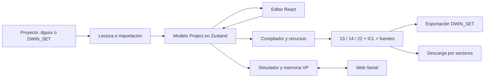

# Análisis técnico de T5L Studio

> Diagnóstico del 18/11/2026. Los fallos P1 y la mayoría de los P2 se corrigieron en las etapas 1–3 ([ETAPAS.md](ETAPAS.md)); lo pendiente está ordenado en [PLAN.md](PLAN.md).

Fecha: 18 de noviembre de 2026. Versión: 0.1.0. Commit revisado: `eb30c64`.

Este informe conserva el diagnóstico anterior a las correcciones. El estado posterior de implementación y pruebas se registra en [ETAPAS.md](ETAPAS.md).

El alcance de la migración se precisó durante esta revisión: conservar las funciones de V7.651 para sus pantallas DWIN compatibles, mejorar la fidelidad de la simulación y generar el paquete de carga con un botón. La investigación oficial y la propuesta de implementación están en [MIGRACION_COMPATIBILIDAD_DWIN.md](../docs/MIGRACION_COMPATIBILIDAD_DWIN.md). Los fallos de este informe son trabajo de estabilización necesario para ese objetivo.

T5L Studio tiene una base funcional y una separación útil entre el editor y la codificación binaria. La compilación pasa y las 36 pruebas existentes también, incluidas las comparaciones con 10 proyectos reales. Sin embargo, encontré fallos reproducibles que pueden perder cambios, alterar valores iniciales o producir archivos que el propio importador no puede recuperar correctamente. Recomiendo resolver esos fallos antes de usarlo como editor habitual de proyectos que se cargarán en una pantalla.

La compatibilidad demostrada tiene un alcance concreto: las 10 muestras actuales usan el modo normal y contienen 9 de los 48 tipos de control. No equivale a haber verificado todos los controles, los tres modos de salida y el funcionamiento físico del dispositivo.

**Alcance y método**

La carpeta superior contiene la distribución original de DGUS V7.651, con ejecutables, DLL, herramientas auxiliares y configuración. El código del producto nuevo está en `DGUS-Studio`, que tiene su propio repositorio Git. Revisé su arquitectura, persistencia, compilador, importación, controles, recursos, simulación, comunicación serie y empaquetado.

La revisión combinó lectura de código, ejecución de la suite existente, compilación, arranque de Electron y pruebas adicionales en memoria. Las muestras del usuario se consultaron en modo de lectura. No modifiqué el código de la aplicación ni los proyectos originales. La compilación regeneró `dist`, que está excluido de Git. Los archivos añadidos al repositorio son este informe y el documento de migración.

No conecté una pantalla ni un adaptador serie real. No ejecuté el instalador. La inspección posterior de algunas clases originales fue puntual y no constituye una auditoría de sus binarios. Las conclusiones sobre fallos internos se apoyan en reproducciones locales; la conformidad con el firmware todavía necesita verificación física.

**Qué hace el sistema y cómo está organizado**

El producto es un editor local para interfaces DWIN T5L. Puede ejecutarse en navegador o como aplicación Electron. No encontré un servidor propio, cuentas de usuario ni una base de datos remota.

| Capa | Responsabilidad | Evaluación |
|---|---|---|
| `src/core/types.ts`, `project.ts` | Modelo del proyecto y archivo JSON `.dgusx` | Fácil de inspeccionar; falta validar los datos al abrirlos y gestionar versiones |
| `src/core/controls/` | Registro de 48 controles, propiedades, codificación y decodificación | Buena centralización; hay pérdidas en algunos recorridos de importación |
| `src/core/build.ts` | Generación de 13, 14 y 22 | Es la parte que más necesita validaciones de límites |
| `src/core/importer.ts`, `icl.ts`, `fonts.ts` | Lectura de proyectos, imágenes y fuentes | Las muestras reales aportan evidencia útil, con cobertura parcial |
| `src/core/protocol.ts`, `simulator.ts` | Tramas, sectores y memoria VP | Separación adecuada; faltan límites y comprobaciones de integridad |
| `src/ui/store.ts` | Estado del editor, selección e historial | Sencillo de seguir; copia el proyecto completo en cada cambio |
| `src/ui/actions.ts`, `comm.ts` | Guardado, exportación y operaciones serie | Concentran varios fallos de estado y concurrencia |
| `electron/` | Ventana, archivos, diálogos y permisos serie | Usa aislamiento y sandbox; necesita completar el control del cierre y el endurecimiento del puente |



El núcleo no depende de React. Los controles se describen con `ControlDef`, que reúne campos, codificación, inicialización y vista previa. Esta decisión permite ampliar el editor sin duplicar toda la lógica en la interfaz. El puente de Electron expone operaciones concretas en lugar de entregar Node.js al renderer.

El código de `src`, `electron` y `scripts` ocupa 44 archivos y 10.029 líneas no vacías según `Measure-Object -Line`, incluyendo estilos y pruebas. El repositorio tiene un commit y no tiene un remoto configurado. No encontré configuración de integración continua.

**Verificaciones ejecutadas**

| Comprobación | Resultado observado |
|---|---|
| `npm test` con `DGUS_SAMPLES` | 4 archivos de pruebas y 36 pruebas aprobadas |
| Comparación de proyectos originales | 10 proyectos; se comparan 13, 14, 22 cuando existe y la reconstrucción de sus ICL |
| `npm run build` | TypeScript y Vite completan correctamente |
| `DGUS_SMOKE=1 npx electron .` | `electron: true`, 48 herramientas y 8 controles en la página inicial |
| Variación de campos y recodificación | 1.245 casos decodificables, con 4 diferencias reproducibles |
| Casos adicionales de guardado y compilación | Confirman los fallos detallados más abajo |
| Comunicación serie con streams simulados | Confirma aceptación de CRC incorrecto y pérdida de una respuesta rápida |
| `npm audit` | 23 paquetes afectados: 3 críticos, 14 altos y 6 moderados |
| `npm audit --omit=dev` | 0 paquetes afectados en el árbol clasificado como producción |
| Firma del instalador existente | `NotSigned`; el instalador ocupa 84.025.422 bytes |

La prueba de arranque no comprueba todas las interacciones. Su implementación imprime conteos y sale con código cero al cargar, sin exigir que los conteos tengan valores mínimos. Es evidencia de que el montaje actual funciona; no es una prueba completa del editor.

El build genera un JavaScript de 1.021,25 kB, o 220,07 kB comprimido con gzip, y CSS de 18,53 kB. Vite avisa del tamaño del paquete y de imports dinámicos que no separan módulos porque también se importan de forma estática.

**Qué cubren realmente las muestras**

Las 10 carpetas que encuentra actualmente la suite suman 49 páginas, 467 controles táctiles, 97 controles de visualización y 20 archivos ICL. No contienen controles importados como bloques originales. Todos los proyectos usan `showFileMode: normal`.

| Tipo | Instancias |
|---|---:|
| `basicTouch` | 392 |
| `incAdjust` | 55 |
| `bitIcon` | 46 |
| `dataVar` | 38 |
| `dataInput` | 18 |
| `iconVar` | 11 |
| `text` | 2 |
| `bitButton` | 1 |
| `textInput` | 1 |

Las otras 39 clases no aparecen en esas muestras. La prueba que recorre todos los controles comprueba el tamaño de sus bloques; solo algunos controles tienen expectativas explícitas sobre los bytes. La prueba XOR comprueba reversibilidad, pero no demuestra por sí misma equivalencia con un archivo cifrado externo.

Además, `22_Config.bin` se conserva como base al importar. Esto ayuda a preservar datos, pero significa que su igualdad al exportar no demuestra que el generador pueda reconstruir desde cero todos los valores presentes en las muestras.

**Fallos prioritarios**

Uso P1 para fallos que conviene corregir antes del uso habitual, por pérdida silenciosa de trabajo o alteración de datos. P2 identifica casos más acotados y límites que deben formar parte de la siguiente estabilización. La prioridad considera el efecto; no implica que todos los casos se presenten con la misma frecuencia.

1. **P1. El guardado puede marcar como guardados cambios que no llegaron al archivo.**

   Referencias: [actions.ts:30](../src/ui/actions.ts:30), [App.tsx:98](../src/ui/App.tsx:98), [main.cjs:70](../electron/main.cjs:70).

   Si el diálogo de Electron devuelve `null` al cancelar, `saveProject` llama igualmente a `markSaved` y borra `dirty`. Reproducción: editar un proyecto nuevo, simular cancelación de «Guardar como» y comprobar `dirty`. El resultado es `false` con `filePath: null`, sin haber escrito el proyecto.

   También hay una carrera: se serializa una versión, se espera al guardado y luego se marca todo el estado actual como guardado. Si el usuario edita durante la espera, esa edición posterior queda con `dirty: false` aunque no esté en el contenido enviado a disco. Ambos casos se reprodujeron.

   Por lectura del código, el aviso de cierre solo se activa cuando `!isElectron()`. La aplicación de escritorio no tiene un manejador equivalente del cierre en el proceso principal. Tampoco encontré recuperación automática del proyecto; `localStorage` solo conserva el tema.

   Corrección propuesta: distinguir cancelación de éxito, asociar el guardado a una revisión concreta del proyecto y comprobar esa revisión antes de limpiar `dirty`. Completar el cierre de Electron con guardar, descartar o cancelar. Usar escritura temporal y reemplazo del archivo para reducir el riesgo de truncamiento si falla la escritura.

2. **P1. La inicialización de byte alto y byte bajo está invertida respecto al modelo y al simulador.**

   Referencias: [display.ts:1303](../src/core/controls/display.ts:1303), [init.ts:43](../src/core/controls/init.ts:43), [simulator.ts:37](../src/core/simulator.ts:37).

   `VAR_TYPES` y el simulador identifican el tipo 2 como byte alto y el tipo 3 como byte bajo. La tabla `INIT_CODE_BY_VARTYPE` envía esos tipos a los códigos 2 y 1, respectivamente, mientras que `encodeInitValue` interpreta el código 2 como byte bajo y el 1 como alto.

   Reproducción: `dataVar`, VP `5000`, inicial `18`. Con tipo 2 genera `[00,12]`; con tipo 3 genera `[12,00]`. Al leer cada configuración con el tipo seleccionado, el simulador obtiene `0` en ambos casos. No hay errores de compilación.

   Corrección propuesta: unificar la semántica en una tabla compartida y fijar expectativas independientes de bytes. Contrastar estos dos casos con la herramienta original o una pantalla para cerrar la compatibilidad externa.

3. **P1. Un texto inicial puede sobrescribir variables vecinas sin diagnóstico.**

   Referencias: [display.ts:1313](../src/core/controls/display.ts:1313), [build.ts:195](../src/core/build.ts:195), [build.ts:219](../src/core/build.ts:219).

   `initText` escribe el texto completo sin comprobar `textLength`. El análisis de solapamientos usa la longitud declarada, de modo que tampoco detecta los bytes adicionales.

   Reproducción: texto en VP `5000`, longitud de 2 bytes e inicial `ABCDEFGHIJ`; variable numérica en VP `5001` con inicial `1234`. El valor final de la variable numérica pasa a ser `17220`, equivalente a los bytes `43 44` de «CD». La compilación solo emite el mensaje informativo de éxito.

   Corrección propuesta: validar el tamaño codificado, incluyendo UTF-16, antes de escribir. La comprobación debe basarse también en los intervalos efectivos de las inicializaciones. Un texto demasiado largo debe dar un error claro o requerir un truncamiento explícito.

4. **P1. El modo de bloques fijos omite cabeceras o controles sin avisar.**

   Referencias: [build.ts:130](../src/core/build.ts:130), [build.ts:153](../src/core/build.ts:153).

   La cabecera se escribe dentro del bucle de controles de la página 0. Si esa página está vacía, no se escribe. Un proyecto nuevo con modo `fixed` compila sin errores, pero su archivo empieza con ceros y `parseShowFile` lo rechaza por falta de cabecera. También debe contemplarse un proyecto sin página 0.

   La cabecera ocupa una de las entradas de la página 0, pero la validación permite tantos controles como `varsPerPage`. Con 64 controles y capacidad 64, se generan 63, sin error. El mismo límite afecta a las capacidades 128 y 256.

   Corrección propuesta: emitir la cabecera independientemente del contenido, definir la política para la página 0 y reservar su entrada en el cálculo de capacidad.

5. **P1. El índice normal puede desbordar sus offsets de 16 bits.**

   Referencias: [build.ts:38](../src/core/build.ts:38), [build.ts:138](../src/core/build.ts:138), [importer.ts:63](../src/core/importer.ts:63).

   `indexEntry` guarda solo los 16 bits bajos del offset, aunque el acumulador sigue creciendo. No existe una validación del tamaño global que impida perder los bits superiores.

   Reproducción: 8 páginas con 255 variables numéricas cada una. El compilador genera 2.040 controles sin errores. La página 7 debería empezar en `0x11F20`, pero su índice contiene `0x1F20`, que apunta al propio índice. Al analizar el archivo se obtienen bloques de datos incorrectos.

   Corrección propuesta: determinar el límite real admitido por el formato original y rechazar proyectos que no puedan representarse, o implementar la extensión correspondiente si se verifica que existe. No basta con ampliar el lector: el archivo que recibe la pantalla debe ser válido.

6. **P1. Las tramas con CRC incorrecto se ejecutan.**

   Referencias: [protocol.ts:120](../src/core/protocol.ts:120), [comm.ts:208](../src/ui/comm.ts:208).

   El parser calcula `crcOk: false`, pero `onBytes` solo añade una nota al registro y llama igualmente a `handleFrame`.

   Reproducción con un puerto simulado: modo «PC simula la pantalla», CRC activado y escritura de `0x1234` a VP `5000`, alterando un byte del CRC. La memoria acaba en `4660` y se envía `OK`. El propio registro indica «CRC incorrecto».

   Corrección propuesta: descartar las tramas inválidas antes de modificar memoria, responder a lecturas o actualizar las variables observadas. Validar también la longitud específica de cada comando.

7. **P1. La descarga puede perder la respuesta que esperaba.**

   Referencias: [comm.ts:328](../src/ui/comm.ts:328), [comm.ts:381](../src/ui/comm.ts:381).

   El código espera a que termine `writer.write(req)` antes de registrar el listener de `waitForReply`. El bucle de lectura ya está funcionando durante esa espera.

   Un puerto simulado que responde al recibir la petición reproduce la carrera: solo se escriben los 6 bytes de la solicitud, se pierde la respuesta y unos 8 segundos después aparece «La pantalla no respondió». No se envía el contenido del archivo. El resultado se reprodujo con cierre normal del puerto simulado.

   Corrección propuesta: registrar la espera antes de enviar y cancelarla correctamente si falla la escritura. Mantener una cola única de operaciones serie y verificar qué constituye una respuesta de descarga válida con hardware real.

8. **P1. Los sectores solapados se descargan pese al diagnóstico.**

   Referencias: [protocol.ts:155](../src/core/protocol.ts:155), [comm.ts:351](../src/ui/comm.ts:351).

   `planDownload` informa de solapamientos, pero conserva ambas escrituras. `downloadFiles` registra las advertencias y continúa. También continúa con los sectores válidos cuando un archivo supera el sector 255 y el resto ha sido omitido.

   Reproducción: `32.icl` de 300.000 bytes y `33.icl` de 10 bytes producen los sectores `[32,33,33]`. La segunda escritura al sector 33 puede reemplazar parte del archivo anterior. El ejemplo es sintético; no afirmo que los proyectos actuales tengan ese conflicto.

   Corrección propuesta: separar advertencias informativas de errores que invalidan el plan. Un solapamiento o un archivo parcialmente fuera de flash debe impedir el inicio de la descarga.

**Otros fallos de compatibilidad y edición**

9. **P2. La autoasignación puede entregar una VP que el bloque binario trunca.**

   Referencias: [store.ts:75](../src/ui/store.ts:75), [bytes.ts:16](../src/core/bytes.ts:16), [build.ts:204](../src/core/build.ts:204).

   Si existe una variable en `FFFF`, añadir otra asigna `10000`. Su VP se codifica como `0000` y el compilador no lo rechaza. Debe comprobarse el rango completo de cada variable y comunicar que no hay espacio disponible. `nextFreeVp` también ignora su argumento `words` y no registra todos los punteros secundarios como intervalos reservados.

10. **P2. La importación táctil no conserva páginas superiores a 1023.**

    Referencias: [touch.ts:59](../src/core/controls/touch.ts:59), [importer.ts:32](../src/core/importer.ts:32), [decoders.ts:447](../src/core/controls/decoders.ts:447).

    El editor acepta páginas hasta 4091, pero el lector táctil conserva solo dos bits del byte alto porque comparte espacio con IVR. Un botón creado en la página 1024 se compila sin error y se importa en la página 0. Hay que definir y validar el rango táctil compatible, incluida su relación con IVR, sin asumir que el límite del índice de visualización sirve para todos los archivos.

11. **P2. Los enteros de 64 bits pierden precisión al importar.**

    Referencia: [importer.ts:101](../src/core/importer.ts:101).

    Se convierte `getBigInt64` a `Number` antes de pasarlo a texto. El inicial `9007199254740993` se importa como `9007199254740992` y la siguiente compilación cambia `22_Config.bin`. Debe conservarse como `bigint` hasta obtener su representación decimal. El simulador también convierte int64 a `Number`, por lo que su alcance numérico debe corregirse o explicarse.

12. **P2. Algunas decodificaciones alteran bytes aunque no se edite el control.**

    Referencias: [decoders.ts:36](../src/core/controls/decoders.ts:36), [decoders.ts:333](../src/core/controls/decoders.ts:333), [decoders.ts:643](../src/core/controls/decoders.ts:643).

    La exploración de campos legales, cambiando una propiedad cada vez, encontró estas diferencias al codificar, decodificar y volver a codificar:

    | Control y cambio | Diferencia observada |
    |---|---|
    | `rotateAdjust.r1 = 7` | Cambian bytes de su rectángulo táctil |
    | `rotateAdjust.r1 = 65535` | También cambia el rectángulo |
    | `pageSlide.keying = true` | Cambian los bytes 23 y 24 |
    | `textII.fontHeight = 7` | Se decodifica como 6 y cambia el byte 28 |

    Un caso adicional sobre un bloque importado muestra pérdida por redondeo: brillo binario 254 se transforma en 100 % y luego en 255. Hace falta preservar el valor binario original o usar transformaciones reversibles para los campos cuantizados. En los controles cuyo rectángulo original es independiente de otra geometría hay que conservar ambas representaciones.

    Esta exploración comprueba consistencia interna, no equivalencia con el DGUS original. Los casos que pasan aún necesitan referencias externas cuando el formato no está verificado.

13. **P2. Cambiar el número de una página deja enlaces al número anterior.**

    Referencia: [store.ts:182](../src/ui/store.ts:182).

    Con un botón `picNext: 1`, renumerar la página 1 a 7 deja el botón apuntando a 1. El compilador no avisa de ese destino inexistente. Lo mismo debe revisarse para teclados, menús, efectos de presión y otros campos que contienen números de página. La operación necesita actualizar referencias de forma transaccional o presentar una decisión explícita sobre ellas.

14. **P2. Las codificaciones asiáticas disponibles no se codifican realmente.**

    Referencias: [schema.ts:253](../src/core/controls/schema.ts:253), [init.ts:73](../src/core/controls/init.ts:73).

    La interfaz permite GB2312, GBK, BIG5 y Shift-JIS, pero `encodeText` usa el byte bajo de cada carácter para todos los modos salvo Unicode. «中» con GB2312 produce `[2D]`, el código de un guion. El comentario del archivo reconoce la limitación, pero la selección no da un error ni la explica. Implementar las codificaciones con vectores conocidos o impedir la exportación de texto que no se pueda representar.

15. **P2. Los proyectos y algunos datos numéricos se aceptan sin validación suficiente.**

    Referencias: [project.ts:72](../src/core/project.ts:72), [store.ts:185](../src/ui/store.ts:185), [importer.ts:52](../src/core/importer.ts:52).

    `deserialize` comprueba el marcador `format`, pero acepta una versión 99. No valida el esquema completo, tipos de controles, dimensiones, identificadores, propiedades ni recursos. En la operación de renumerado, `NaN` supera las comparaciones de rango y se acepta como ID; una entrada no numérica en el diálogo puede activar ese recorrido.

    Los parsers binarios tampoco comprueban de forma sistemática todos los límites de bloques, índices y longitudes antes de decodificar. Deben rechazar archivos truncados con una explicación localizada, en vez de producir controles parciales o errores secundarios. Añadir validación de esquema al abrir y una fase de validación del proyecto anterior a cualquier asignación de buffers o codificación.

16. **P2. La caché de fuentes puede reutilizar una fuente de otro proyecto.**

    Referencia: [fontRender.ts:101](../src/ui/fontRender.ts:101).

    La clave de `projectAsciiLib` usa nombre, longitud y los primeros 32 caracteres base64. Dos fuentes ASCII 0# pueden tener el mismo tamaño y prefijo, ya que empiezan con caracteres vacíos. En una reproducción con dos bibliotecas distintas, el segundo proyecto recupera el mismo objeto de la primera: un byte que debería valer 255 sigue valiendo 0.

    La caché de texto usa longitud y un único byte de la biblioteca como parte de la identidad, por lo que también admite colisiones. Usar una identidad de recurso que cambie con su contenido y limpiar las referencias al sustituir un proyecto o recurso.

17. **P2. Quitar un fondo importado puede conservarlo en el ICL exportado.**

    Referencia: [actions.ts:68](../src/ui/actions.ts:68).

    El generador empieza con todas las imágenes del ICL original y solo reemplaza páginas que tienen fondo. Una página cuyo `background` se ha eliminado no retira su imagen del mapa original. Reproducción sin DOM: proyecto con página 0 sin fondo y un ICL original con imagen 0; `buildBackgroundIcl` vuelve a exportar la imagen 0.

    Hace falta distinguir «conservar recurso importado» de «eliminación solicitada». Al exportar sobre una carpeta existente, el proceso principal tampoco retira archivos que dejaron de pertenecer al proyecto. Conviene definir un manifiesto de salida y generar primero una carpeta limpia de preparación, preservando cualquier archivo ajeno hasta una decisión explícita.

18. **P2. Las tramas largas desbordan el campo LEN.**

    Referencias: [protocol.ts:30](../src/core/protocol.ts:30), [comm.ts:296](../src/ui/comm.ts:296).

    `frame` permite un cuerpo mayor de 255 bytes y lo asigna a un solo byte. Una respuesta con 510 bytes de datos genera una trama de 517 bytes cuyo LEN vale 2; el propio parser interpreta un primer fragmento de solo 5 bytes. Es alcanzable con lecturas grandes del MCU en modo pantalla o textos extensos en operaciones que no limitan su tamaño.

    Validar los máximos de lectura y escritura según comando y CRC, y dividir las operaciones cuando el protocolo lo permita. Verificar los límites reales del firmware, que pueden ser más estrictos que el máximo representable por LEN.

19. **P2. El plan de descarga visible puede quedar desactualizado respecto al proyecto.**

    Referencia: [Output.tsx:256](../src/ui/components/Output.tsx:256).

    Por lectura del código, los archivos preparados se guardan en estado local y no se invalidan cuando cambia el proyecto. Si se prepara, se edita y se descarga sin volver a preparar, se envían los archivos anteriores. El mismo componente puede conservar ese estado al abrir otro proyecto mientras la pestaña sigue montada. Asociar el plan a una revisión y bloquear o regenerar la descarga al cambiarla. Este punto no se verificó con una interacción completa de la interfaz.

**Dependencias y seguridad de escritorio**

Las versiones principales están fijadas en React 18.3.1, Zustand 5.0.1, TypeScript 5.6.3, Vite 5.4.11, Vitest 2.1.5 y Electron 33.2.0. El lockfile aporta reproducibilidad, pero también fija versiones con avisos de seguridad.

Los 23 paquetes afectados que informa `npm audit` pertenecen al árbol de herramientas de desarrollo según npm. Eso requiere dos matices:

- `vite` y `vitest` no forman parte del JavaScript de producción, y varios avisos dependen de tener activos sus servidores. El script de pruebas usa `vitest run`; no demuestra que haya un servidor de pruebas expuesto.
- Electron figura en `devDependencies`, pero es el runtime de la aplicación que se distribuye. Por eso el resultado limpio de `npm audit --omit=dev` no basta para evaluar el instalador.

El aviso de [Vite GHSA-vg6x-rcgg-rjx6](https://github.com/vitejs/vite/security/advisories/GHSA-vg6x-rcgg-rjx6) incluye la versión 5.4.11 y describe un problema del servidor de desarrollo que también puede afectar al uso local. El aviso de [Vitest GHSA-9crc-q9x8-hgqq](https://github.com/vitest-dev/vitest/security/advisories/GHSA-9crc-q9x8-hgqq) incluye 2.1.5 y depende de que su servidor API esté escuchando. Son ejemplos verificados en fuentes de los propios proyectos; no prueban que se haya explotado esta aplicación.

La ventana configura `contextIsolation: true`, `nodeIntegration: false` y `sandbox: true`. Son medidas apropiadas. Por otra parte, faltan una política CSP y validaciones explícitas de los emisores y argumentos IPC; tampoco encontré restricciones explícitas de nuevas ventanas y navegación. No demostré una explotación de estos puntos. Son tareas de endurecimiento coherentes con la [guía oficial de seguridad de Electron](https://www.electronjs.org/docs/latest/tutorial/security), especialmente junto con la actualización del runtime.

El puente de exportación usa `path.basename`, que evita aceptar directamente rutas relativas con directorios para los nombres exportados. El guardado usa una ruta recibida del renderer y los manejadores no validan su origen. Conviene restringir esa capacidad a rutas seleccionadas o abiertas por la propia aplicación.

El instalador existente está presente y no está firmado. Su instalación, desinstalación, asociación de `.dgusx` y funcionamiento en una máquina limpia no se comprobaron. La firma debe abordarse después de estabilizar el comportamiento y validar el paquete.

**Límites funcionales y mantenimiento**

El editor registra 32 controles de visualización y 16 táctiles. Al probar la codificación por defecto de cada uno, 7 vuelven por la vía de bloque original: `dataWindow`, `rollerChar`, `gtf`, `zoneScroll`, `zoneBrightness`, `camera` y `video`. La documentación de continuación habla de 10; conviene actualizarla para describir el estado del commit actual.

La preservación de esos bloques es útil, pero no ofrece edición semántica. En particular, `rawDisplay.encode` conserva sus bytes sin aplicar la geometría visible. Mover uno de estos controles en el lienzo puede no moverlo en la salida. La interfaz debería dejar claro qué propiedades son editables de forma efectiva.

El simulador cubre un subconjunto de los comportamientos táctiles. Usa cuadros de entrada del navegador para datos y texto; no reproduce los teclados DGUS. Varias vistas son aproximaciones: curva, reloj analógico y QR se dibujan con muestras. El QR visible no es una codificación del contenido real. No debe tratarse una previsualización como evidencia de que esos controles funcionarán igual en el dispositivo.

La variable de sistema de página actual tampoco se actualiza de forma centralizada cada vez que se cambia la página simulada. El método `applyWrite` devuelve la nueva página al recibir una escritura en `0084`, pero no sincroniza por sí mismo `SYS.pageId`. El modo «PC simula la pantalla» necesita una matriz explícita de registros y comportamientos soportados para poder usarlo como referencia al depurar firmware.

Quedan pendientes documentados el generador de teclados, la lectura de nombres y metadatos de `DWprj.hmi`, la vista previa completa de fuentes y la validación física de fuentes grises o de mapa de bits. La propiedad `rotation` existe en el modelo, pero solo encontré su definición y valor por defecto; no hay comportamiento aplicado a partir de ella.

En rendimiento, `Icon.tsx` consulta el registro completo de Lucide. Es una causa visible de inclusión de muchas definiciones en el bundle, aunque no medí el ahorro de reemplazarlo. Los generadores de fuentes hacen trabajo síncrono sobre el hilo de la interfaz y el historial clona el proyecto completo. En las muestras leídas solo con BIN e ICL, el mayor proyecto serializado fue de unos 0,95 MiB y una copia individual tardó menos de 1 ms en esta máquina. Esa medición no incluye todas sus fuentes; no demuestra que un proyecto con recursos grandes mantenga el mismo rendimiento.

Separar recursos binarios del estado editable y conservarlos por identidad permitiría evitar copias en el historial. Conviene medir un proyecto con fuentes e imágenes grandes antes de decidir cambios de arquitectura. La generación pesada puede trasladarse a un worker con progreso y cancelación.

**Orden de trabajo recomendado**

1. Corregir la preservación del trabajo: cancelación de guardado, revisión guardada, aviso de cierre en Electron y escritura segura. Criterio de aceptación: cancelar nunca cambia `dirty`, y una edición posterior al inicio del guardado sigue pendiente.
2. Hacer que el compilador rechace todo proyecto que no pueda representar. Incluir bytes alto/bajo, límites VP, longitud efectiva de textos, capacidad de la página 0 y offsets del índice. Criterio: ninguna de las reproducciones de corrupción genera una salida presentada como válida.
3. Estabilizar Web Serial: rechazo de CRC, espera previa al envío, cola de operaciones, plan sin colisiones y control de revisión. Añadir un puerto simulado con respuestas inmediatas, partidas, corruptas y ausentes.
4. Ampliar las referencias binarias. Conservar casos mínimos sanitizados que puedan estar en el repositorio y obtener salidas independientes para cada control y modo. Las muestras privadas deben seguir siendo una comprobación adicional, con un recuento explícito de las que se ejecutaron.
5. Validar con una pantalla T5L un proyecto creado desde cero. Comprobar SD, valores iniciales, teclados, fuentes, lectura/escritura de VP, CRC y descarga. Registrar modelo de pantalla, firmware, configuración y resultados.
6. Actualizar herramientas y Electron en un cambio separado, revisar de nuevo los avisos y verificar el paquete. Añadir integración continua para typecheck, pruebas y build; después completar la firma del instalador y las pruebas en una máquina limpia.

No recomiendo añadir más controles antes de cerrar los puntos que alteran datos o pierden cambios. La estructura actual permite corregirlos sin reescribir el editor completo.

**Comandos para repetir la verificación disponible**

Desde `<carpeta-de-DGUS-V7.651>\DGUS-Studio`, en PowerShell:

```powershell
$env:DGUS_SAMPLES = '<carpeta-de-proyectos-DGUS>'
npm test
npm run build
$env:DGUS_SMOKE = '1'
npx electron .
Remove-Item Env:DGUS_SMOKE
npm audit
npm audit --omit=dev
```

Las reproducciones adicionales se ejecutaron en memoria, empaquetando temporalmente módulos con el esbuild ya instalado. No se incorporaron como pruebas al código. Para convertir el análisis en correcciones, conviene fijar cada caso como una regresión que exprese el resultado esperado y comprobar los casos binarios contra una referencia independiente.
