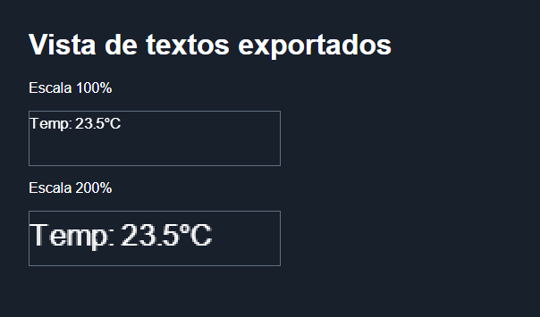
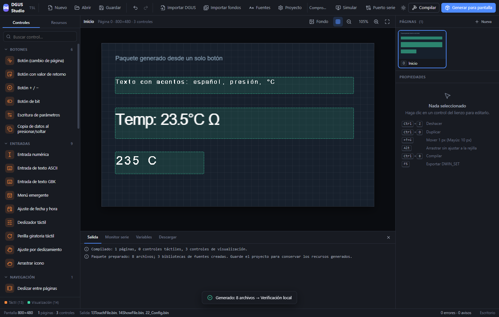
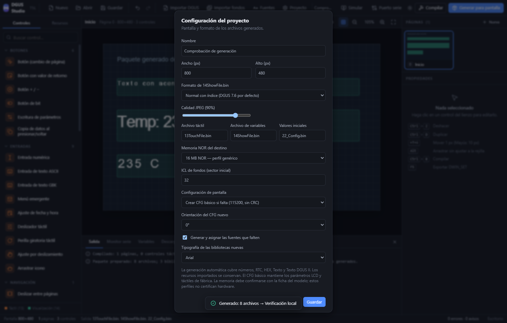

# Registro de etapas de la migración

Este archivo registra el cierre de cada etapa: alcance aplicado, comprobaciones realizadas y pendientes. La cobertura se evalúa contra V7.651 y los perfiles de hardware y firmware descritos en [MIGRACION_COMPATIBILIDAD_DWIN.md](MIGRACION_COMPATIBILIDAD_DWIN.md).

## Etapa 1. Protección del trabajo y validaciones del compilador

Fecha de cierre: 18 de noviembre de 2026. Estado: implementada y verificada localmente.

Se corrigieron fallos que podían ocultar cambios pendientes o generar archivos con datos truncados. Esta etapa prepara el núcleo para la vista previa fiel y la generación integrada; no completa toda la estabilización descrita en el análisis inicial.

### Cambios aplicados

- Cancelar el guardado de Electron conserva el estado pendiente. Los fallos de escritura se comunican y tampoco limpian ese estado.
- El guardado identifica el documento y la revisión escritos. Las ediciones posteriores siguen pendientes y terminar un guardado antiguo no cambia la ruta de otro proyecto abierto. Se impiden escrituras simultáneas desde la acción de guardar.
- La escritura del proyecto usa un temporal exclusivo en la misma carpeta, sincroniza su contenido y reemplaza el destino. Si falla el reemplazo, conserva el archivo anterior y limpia su temporal.
- El cierre de Electron ofrece seguir editando o descartar cuando el renderer indica cambios pendientes. Para guardarlos, el usuario puede volver al editor y guardar.
- Se corrigió la inicialización de los tipos byte alto y byte bajo y se conserva la precisión decimal de int64 al importar valores iniciales.
- Un texto inicial que excede la longitud declarada da error antes de escribir la memoria, contando bytes de UTF-16 cuando corresponde.
- El compilador valida resolución, geometría representable, IDs enteros de página, direcciones y extensión de los intervalos VP. El renumerado también rechaza valores no enteros.
- El modo fijo genera la cabecera incluso con la página 0 vacía o ausente y reserva su entrada al calcular la capacidad. Se mantiene el máximo de 255 controles de visualización por página.
- El formato normal y el cifrado rechazan una página cuyo inicio desborda el offset de 16 bits del codificador actual. Los controles táctiles en páginas superiores a 1023 dan error para impedir su pérdida en la importación actual.
- Si falla la validación previa, el resultado contiene diagnósticos y buffers vacíos; exportar DWIN_SET queda bloqueado por los errores.

### Pruebas y resultados

Se añadieron 26 pruebas de regresión en `src/core/__tests__/safety.test.ts`, `src/ui/__tests__/save.test.ts` y `src/ui/__tests__/project-file.test.ts`.

| Comprobación | Resultado |
|---|---|
| Suite con `DGUS_SAMPLES` | 62 pruebas aprobadas en 7 archivos |
| Proyectos originales | 10 comparaciones de ida y vuelta aprobadas; 13/14/22 e ICL conservan los bytes comprobados |
| TypeScript | `npx tsc --noEmit` aprobado; también incluido en el build |
| Compilación | `npm run build` aprobado |
| Arranque de Electron | Puente disponible, 48 herramientas y 8 controles en la página inicial |
| Integridad del diff | `git diff --check` aprobado |

Las pruebas de disco verifican que un reemplazo fallido conserva el original y no deja temporales. Las pruebas de guardado cubren cancelación, escritura correcta, edición durante la espera, cambio de documento, intento simultáneo y fallo de escritura. Las del núcleo comprueban casos de borde y conservación de un int64 superior a la precisión de `Number`.

Vite conserva avisos por tamaño del bundle e imports dinámicos sin separación efectiva. Electron emitió un aviso del proceso GPU durante la prueba de arranque; la prueba terminó con código cero. No se ejecutó una instalación nueva ni se probó una pantalla física. El diálogo de cierre está implementado, pero su interacción manual completa sigue pendiente de verificación.

Los proyectos del usuario se usaron solo para lectura. No se modificaron ni se incorporaron al repositorio. El instalador de `release` no se regeneró; ejecutar ese instalador anterior no incluye estos cambios.

### Límites y siguientes etapas

Los límites de offset y página táctil son protecciones de los formatos actualmente implementados, no una afirmación de límites universales de DWIN. Cualquier ampliación necesita referencias externas y pruebas del perfil correspondiente.

Siguen pendientes la validación completa del esquema `.dgusx`, la autoasignación VP cuando se agota el espacio, las referencias al renumerar páginas, los fallos de comunicación serie, la fidelidad visual, los recursos y las particularidades de cada destino. Estos puntos permanecen descritos en el análisis y no se consideran resueltos por el cierre de esta etapa.

La siguiente etapa será la representación de textos y fuentes: compartir métricas y recursos con la salida, respetar la escala de Texto DGUS II y sustituir las aproximaciones visuales que ocultan desbordamientos. Después se integrará la generación completa y se ampliarán los perfiles y las pruebas de paridad.

Para repetir los controles desde la carpeta del proyecto en PowerShell:

```powershell
$env:DGUS_SAMPLES = '<carpeta-de-proyectos-DGUS>'
npm test
npm run build
$env:DGUS_SMOKE = '1'
npx electron .
Remove-Item Env:DGUS_SMOKE
git diff --check
```

## Etapa 2. Representación de texto con los recursos exportados

Fecha de cierre: 18 de noviembre de 2026. Estado: implementada la base de representación y verificada localmente; pendiente validación física por perfil.

Se sustituyó la representación CSS de los controles Texto y Texto DGUS II por un lienzo que lee el bloque de control codificado y los glifos de la biblioteca incluida. Con ello, cambiar la escala modifica el tamaño dibujado sin depender del alto del rectángulo de selección.

### Cambios aplicados

- `src/core/textLayout.ts` interpreta las áreas, longitudes, escala y espaciados del bloque exportado. Produce un mapa de transparencia sin dependencias del navegador.
- La ruta de Texto admite bibliotecas de matriz fija de 8 bits y Unicode, además de la biblioteca ASCII 0# cuando las dimensiones coinciden. Texto DGUS II usa la biblioteca DGUS_2 en grises. No se sustituye silenciosamente un glifo ausente por una fuente del PC.
- La escala DGUS II se toma del byte cuantizado en unidades de 1/16. La representación ya distingue 100 % de 200 %. El zoom solo cambia las dimensiones de presentación del lienzo.
- Se aplican separación de caracteres y líneas, saltos CR/LF, ajuste de línea por ancho, alineación horizontal en una sola línea y centrado vertical para texto de matriz. La representación recorta el contenido que excede su área, sin encogerlo para que parezca caber.
- El lienzo señala fuentes ausentes, glifos que no se pueden leer, codificaciones pendientes y texto recortado. Los textos numéricos, RTC, HEX o desplazados que aún usan una aproximación la identifican como tal.
- Se eliminó el límite CSS que reducía el tamaño de texto para ajustarlo al alto del control y se retiraron el relleno y el centrado vertical artificiales de esa ruta aproximada.
- Las cachés identifican la fuente por su contenido completo y las imágenes de texto por la biblioteca concreta. Sustituir un archivo por otro con el mismo nombre, tamaño y prefijo ya no recupera la fuente anterior.
- Los lectores rechazan glifos grises truncados y códigos o tamaños ASCII no representables. Se eliminó la máscara que convertía símbolos fuera de ASCII en otros caracteres.
- Se limita el área de representación para evitar asignaciones desmesuradas al abrir recursos defectuosos. Este límite pertenece a la vista previa, no modifica los archivos de pantalla.
- El control Texto DGUS II se denomina «fuente en grises» en la interfaz; su representación ya no depende de una supuesta altura tipográfica calculada a partir del rectángulo.

### Pruebas y resultados

Se añadieron 22 pruebas: 19 para la representación de texto y 3 para la identidad de los recursos. Verifican escala, cuantización, recorte, alineación, espaciado, límites por bytes Unicode, terminadores, glifos ausentes, archivos truncados y sustitución de bibliotecas.

| Comprobación | Resultado |
|---|---|
| Suite completa con muestras | 84 pruebas aprobadas en 9 archivos |
| Compatibilidad con proyectos originales | Las 10 comparaciones byte a byte siguen aprobadas |
| TypeScript y build | `npm run build` aprobado |
| Arranque de la aplicación | Electron disponible, 48 herramientas y 8 controles iniciales |
| Componente real en Electron | Dos lienzos de 280×60; altura de tinta de 15 px a 100 % y 30 px a 200 % |
| Revisión visual | Captura inspeccionada; se observa la duplicación del tamaño sin reducir el texto para ajustarlo |
| Integridad del diff | `git diff --check` aprobado |

La comprobación del componente usó una biblioteca DGUS_2 generada con celda de 16×24 y el texto «Temp: 23.5°C», incluyendo el símbolo de grado. La biblioteca se leyó por la misma ruta que los recursos del proyecto. El escenario visual fue temporal y no utilizó ni modificó proyectos originales.



### Límites y siguiente etapa

Esta representación es una referencia del editor a partir de sus recursos. No certifica todavía igualdad de píxeles con todos los firmwares. Deben contrastarse con hardware el redondeo del escalado, los modos de ajuste proporcional, el comportamiento de los saltos y las variaciones COB/COF. Las bibliotecas grises y de matriz siguen necesitando referencias externas adicionales, como ya indicaba el análisis.

GB2312, GBK, BIG5 y Shift-JIS se identifican como pendientes de representación verificada. Esta etapa tampoco cambia su codificación de inicialización. No se han completado los formatos GTF, las fuentes grises especiales para variables numéricas, ni la animación real del texto desplazado.

Una biblioteca que no está incluida deja un aviso y no se reemplaza por glifos inventados en los controles Texto/Texto DGUS II. El siguiente bloque debe integrar la creación y asignación automática de fuentes y recursos en la generación completa, junto con la selección de destino y la validación del paquete. Hasta esa integración, el usuario debe añadir la biblioteca desde las herramientas de fuentes o importar la existente.

Vite mantiene los avisos de tamaño e imports ya registrados. El arranque vuelve a emitir el aviso GPU con salida cero. No se regeneró el instalador ni se probó una pantalla física.

## Etapa 3. Generación integrada y comprobación del paquete

Fecha de cierre: 18 de noviembre de 2026. Estado: implementada y verificada localmente para el alcance descrito; pendiente carga física por perfil.

«Generar para pantalla» (`F5`) prepara controles, fondos, fuentes y configuración desde una acción. Los errores de compilación o de ocupación de memoria impiden escribir la salida. La selección del destino incluye las resoluciones heredadas y perfiles genéricos de memoria; todavía no es un catálogo de modelos certificados.

### Cambios aplicados

- Los proyectos nuevos pueden generar bibliotecas ausentes para variables numéricas, RTC, HEX, Texto de matriz y Texto DGUS II. Se asignan IDs libres y se actualizan sus referencias antes de compilar. La fuente 0# se asigna primero porque necesita 12 sectores consecutivos; las bibliotecas pequeñas se colocan después.
- Texto de matriz genera una biblioteca fija con Latín-1 y los caracteres iniciales; Texto DGUS II genera DGUS_2 de 24×32 con los caracteres iniciales adicionales. Se admite codificación de 8 bits o Unicode del plano básico. No se truncan en silencio caracteres fuera de estos límites. Las unidades de variables numéricas deben pertenecer a ASCII 0#.
- Los recursos ya presentes se conservan. Cambiar la tipografía elegida afecta a las bibliotecas nuevas, no sustituye fuentes importadas. Los recursos generados se incorporan al proyecto con una operación que puede deshacerse y quedan pendientes de guardar en `.dgusx`.
- El paquete comprueba nombres válidos y únicos, IDs de 13/14/22, sectores compartidos y capacidad NOR declarada. La memoria desconocida produce un aviso y no se presenta como detectada. Se ofrecen capacidades de 8/16/32/64 MB y una opción sin identificar. Para 8 MB, el ICL de fondos debe ubicarse por debajo del sector 32.
- Se valida que el CFG sea único, tenga cabecera reconocida y use el mismo ICL de fondos. Las bibliotecas de fuentes ausentes o no verificadas se señalan; una referencia incompatible bloquea la generación automática. Las bibliotecas de iconos no incluidas generan avisos, pues pueden residir ya en la pantalla.
- Puede generarse un CFG lógico básico si falta: orientación, ICL de fondos, 115200 sin CRC, carga de valores iniciales y subida táctil. No habilita la sustitución de tiempos LCD ni de parámetros TP. Un CFG importado siempre conserva sus bytes.
- La importación recupera el ICL de fondos y la orientación del CFG. Antes se asumía el ICL 32 incluso cuando el CFG indicaba 23. Las imágenes compiladas del ICL conservan sus dimensiones si no se editan, incluidas imágenes parciales de teclado. Las imágenes sueltas ya no agregan páginas cuando existe el ICL de fondos; pueden añadirse expresamente con «Importar fondos».
- El selector añade las resoluciones únicas de `Config/Terminal.ini`, incluida 480×854. Son tamaños de proyecto, no identificadores comerciales ni ajustes de temporización LCD.
- La preparación usa una revisión del proyecto y se cancela si cambia el documento o se edita durante la espera. El plan de descarga queda invalidado cuando cambia el proyecto. Se comunican los fallos de generación y escritura, y se impiden exportaciones simultáneas desde el botón principal.
- El navegador descarga un ZIP único con DWIN_SET/. Electron crea una carpeta nueva: usa DWIN_SET si no existe; si ya existe, escribe en DGUS-…/DWIN_SET y conserva la anterior. No mezcla archivos obsoletos ni sobrescribe el paquete previo. Un fallo de escritura intenta identificar la carpeta como incompleta.

### Hallazgos en los proyectos originales

La comprobación del paquete completo encontró conflictos que las pruebas anteriores del compilador no podían detectar. Los archivos originales solo se leyeron; no se corrigieron, eliminaron ni copiaron al repositorio.

| Carpeta | Conflicto detectado | Resultado de la nueva generación |
|---|---|---|
| Muestra A | `0_DWIN_ASC.HZK` y `1_DWIN_ASC.HZK`, de 3 082 752 bytes cada uno, comparten los sectores 1–11 | Bloqueada con diagnósticos |
| Muestra C (copia) | `23.icl` supera 256 KB y ocupa también el sector 24, usado por `24.icl` | Bloqueada con diagnóstico |
| Muestra C | Solape de ICL 23/24; el CFG selecciona correctamente fondos en 23 | Bloqueada por el solape; selección CFG recuperada |
| Muestra D | Solape de ICL 23/24; el CFG selecciona fondos en 23 | Bloqueada por el solape; selección CFG recuperada |

Las otras seis muestras de recursos compilados pasan por la acción integrada y conservan los binarios y recursos comprobados. Las diez comparaciones previas de 13/14/22 e ICL siguen aprobadas: poder reconstruir un archivo idéntico no demuestra que varios archivos puedan cargarse juntos sin pisarse. Estos solapes son candidatos a problemas de recursos; todavía no prueban por sí solos la causa de los tamaños de texto observados en hardware.

### Pruebas y resultados

Se añadieron 34 pruebas respecto a la etapa 2. Cubren asignación de fuentes, límites de memoria, configuración, ZIP, preservación de archivos, fallos de disco y el flujo integrado con muestras. Las diez pruebas nuevas de muestras verifican seis paquetes conservados y cuatro rechazos esperados por solapes. Se limitan a recursos binarios compilados; no simulan la conversión de BMP/PNG sueltos en Node.

| Comprobación | Resultado |
|---|---|
| Suite con `DGUS_SAMPLES` | 118 pruebas aprobadas en 14 archivos |
| Comparaciones anteriores del compilador | 10 muestras siguen idénticas en los archivos comprobados |
| Acción integrada con muestras | 6 conservadas; 4 conflictos detectados y bloqueados |
| TypeScript y build | `npm run build` aprobado |
| Arranque de Electron | Puente disponible, 48 herramientas y 8 controles iniciales |
| Flujo real de interfaz en Electron | Un clic prepara 8 archivos: 13/14/22, fondo ICL, 3 fuentes y CFG; sin errores ni avisos de fuente en el lienzo del escenario |
| ZIP con lector independiente | Python `zipfile` abre las 8 entradas y aprueba todos los CRC; cabecera y bloques deshabilitados del CFG comprobados |
| Configuración del proyecto | Diálogo inspeccionado; contenido desplazable cuando la ventana lo requiere y pie accesible |
| Integridad del diff | `git diff --check` aprobado |

El escenario visual creó un proyecto propio de 800×480, con «español», «presión», grado y omega. Usó el renderizador de fuentes real y la acción del botón principal; la escritura externa se sustituyó por captura del paquete. Los archivos de salida de ese escenario quedaron en una carpeta temporal. La comprobación de escritura de Electron se cubre aparte con pruebas de disco en temporales.





### Límites y siguiente etapa

La generación automática de esta etapa cubre los cinco grupos citados. No completa fuentes para rodillos, tablas, texto desplazado, GTF ni codificaciones asiáticas. Una biblioteca gris nueva incluye Latín-1 y el texto inicial de ese momento; no puede anticipar todos los caracteres que enviará después el MCU. Las fuentes existentes no se regeneran automáticamente al editar un texto o cambiar de tipografía; puede ampliarse su juego desde «Fuentes». La validación completa de todos los glifos y variantes sigue pendiente.

El CFG se entrega para SD. La descarga serie actual solo transmite recursos NOR numerados y no aplica T5LCFG.CFG. Tampoco se ha ampliado la descarga a NAND ni verificado perfiles físicos COB/COF/T5F0. Elegir una memoria o resolución no certifica un modelo.

El siguiente bloque debe preparar una propuesta de reasignación para los conflictos importados sin romper referencias, revisar los bloques originales que puedan contener IDs y asegurar las esperas y errores del protocolo serie. Después se amplían la matriz funcional y las pruebas físicas de texto y toque. La remediación no debe modificar los proyectos originales del usuario.

Vite mantiene sus avisos de bundle e imports compartidos. No se regeneró el instalador de `release` ni se probó una pantalla física. Los archivos fuente y el build local sí incluyen esta etapa.

## Etapa 4. Hito 1: cerrar lo abierto

Fecha de cierre: 18 de noviembre de 2026. Estado: implementada y verificada localmente; falta hardware real (Hito 2).

### Cambios aplicados

- **Commit** del trabajo de las etapas 1–3 (`2014226`) y `.gitattributes` para normalizar los finales de línea.
- **Archivos que comparten sectores.** La generación ya no se detiene sin salida: lanza `PackageConflictError` y la interfaz muestra un diálogo con dos opciones:
  - **«Reasignar y generar»**: `planReassignment` (en `src/core/package.ts`) deja en su sitio los archivos fijos (13/14/22, CFG e ICL de fondos) y el de número menor, y mueve el otro al primer hueco libre a partir de su número original (el sector 12 queda reservado). Lista las referencias que cambian y avisa de los bloques importados sin decodificar que podrían contener IDs. `applyReassignment` lo aplica sobre una copia del proyecto: se puede deshacer y nunca toca los archivos originales.
  - **«Generar igualmente»**: igual que DGUS 7.6, el solape queda como aviso (`allowOverlap`).
- **Importador**: las imágenes del ICL de fondos que no son páginas (por ejemplo, la imagen 9 de Muestra C) se conservan dentro del ICL pero ya no crean páginas, porque eso cambiaba la página máxima de 14ShowFile. El fallo apareció al probar «Generar igualmente» con las muestras.
- **Puerto serie** (`src/ui/comm.ts`):
  - Las tramas con CRC incorrecto se descartan y se registran como error.
  - Cola de operaciones: lecturas, escrituras y descarga no se mezclan.
  - `request()` registra la escucha antes de escribir (no se pierden respuestas inmediatas). Espera 600 ms y reintenta 2 veces las lecturas.
  - Las escrituras no se reintentan, porque algunos firmwares no responden `OK`.
  - La descarga es exclusiva y también escucha antes de pedir cada sector.
  - Se corrigió un error al desconectar (el lector se liberaba dos veces).
  - Cancelar deja la conexión utilizable.
- **Instalador**: regenerado. Se añadió `build/installer.nsh` para que la desinstalación borre la clave vacía de `.dgusx`. La prueba de humo informa también del proyecto abierto.

### Pruebas y resultados

| Comprobación | Resultado |
|---|---|
| Suite con `DGUS_SAMPLES` | 130 pruebas aprobadas en 16 archivos |
| Las 4 muestras con solapes | «Generar igualmente» da archivos idénticos a los originales; «Reasignar» genera sin solapes y conserva el contenido de cada archivo movido |
| Reasignación sintética (`reassign.test.ts`) | Fuente 0# duplicada, ICL de iconos contra ICL de fondos, bloques sin decodificar y falta de espacio |
| Puerto serie con puerto falso (`serial.test.ts`) | Respuesta inmediata, partida, CRC dañado con reintento, sin respuesta, escritura sin confirmación, cola ordenada, descarga y cancelación |
| Diálogo de conflicto en el navegador | Muestra la propuesta; «Reasignar y generar» mueve la fuente de 1 a 23, actualiza la variable y genera el ZIP |
| Instalador en este PC | Instalación silenciosa, app instalada abriendo un `.dgusx`, comando de apertura en el registro y desinstalación sin restos (programa, accesos, tipo de archivo y extensión) |

No se probó con una pantalla ni con un adaptador USB real. Eso es el Hito 2.

## Etapa 5. Hito 2 preparado: proyecto y guía para la pantalla real

Fecha: 18 de noviembre de 2026. Estado: preparado; pendiente de la prueba física del usuario.

### Cambios aplicados

- `scripts/make-test-project.ts` (`npm run ejemplo`) genera `ejemplos/prueba-t5l.dgusx`, un proyecto de 480×854 sin datos privados:
  - Página 0: número con decimales y unidad, texto ASCII, Texto DGUS II Unicode (ñ, tildes, °), reloj, barra con +/−, dos botones de valor de retorno, botón de bit y entrada numérica.
  - Página 1: teclado numérico con las mismas posiciones y códigos que el teclado de Muestra E, que ya funciona en la pantalla del usuario (`0030`–`0039`, `00F0` ESC, `00F1` OK, `00F2` BORRAR).
  - Página 2: cambio de página y variable compartida.
  - Los fondos se dibujan en el propio script (fuente de píxeles 5×7 y PNG con zlib), para que el resultado sea reproducible.
- `docs/PRUEBAS_HARDWARE.md`: guía paso a paso.
  - Preparar el paquete, eligiendo el ICL de fondos según el CFG que ya tiene la pantalla: 32 para Muestra B, 23 para Muestra C o V0.
  - Cargar por SD.
  - 10 comprobaciones visuales y táctiles y 6 pruebas por puerto serie.
  - Tabla de resultados y cómo restaurar el proyecto original.
- `src/core/__tests__/example.test.ts`: el proyecto de referencia debe compilar siempre sin errores.

### Verificación

| Comprobación | Resultado |
|---|---|
| Suite con `DGUS_SAMPLES` | 132 pruebas aprobadas en 17 archivos |
| Proyecto en la app | 16 controles en la página 0; «Generar para pantalla» crea 7 archivos sin errores: 13/14/22, `32.icl` y 3 fuentes generadas (0# en el ID 0, fija en el 15 y gris en el 16) |
| Simulador | + → 50, VALOR 2 → 2, BIT 0 → 1, textos iniciales (incluido Unicode) correctos e «Ir a página 2» cambia de página |
| Fondos | Revisados visualmente; se corrigió el desbordamiento de las etiquetas de los botones |

## Etapa 6. Hito 3: perfiles de pantalla

Fecha: 18 de noviembre de 2026. Estado: implementada y verificada localmente.

### Cambios aplicados

- **Catálogo de perfiles**:
  - Carpeta `perfiles/` con un JSON por modelo y una guía de campos (`perfiles/README.md`). Incluye tres modelos documentados con sus fichas: DMG80480C070_04W (800×480, 16 MB), DMG48480F021_01W (redonda 480×480, COF, 8 MB, Texto DGUS II sin escala según la guía COF) y DMG19108C156_05WTC (2K 1920×1080, 32 MB).
  - Un perfil **genérico** por cada resolución de V7.651, para que cualquier pantalla DGUS II tenga perfil desde el primer día.
  - `src/core/profiles.ts` carga y valida el catálogo, busca, aplica un perfil (resolución y memoria) y comprueba el proyecto contra él.
- **Selector de perfil** con buscador en «Proyecto nuevo» y en «Proyecto». Muestra modelos y genéricos con resolución, memoria, forma y nivel de verificación, y admite una resolución personalizada. Al cambiar de perfil se avisa de los controles que quedan fuera; se conservan.
- **El perfil se aplica en toda la app**:
  - Máscara circular en el lienzo para pantallas redondas.
  - Aviso al compilar de los controles que salen del círculo.
  - La escala del Texto DGUS II se bloquea al 100 % si el firmware no la admite, con aviso si el proyecto pide otra.
  - El CRC del puerto serie sigue al perfil.
  - La memoria del perfil limita los sectores al generar.
  - La barra de estado muestra el perfil.
- **Versión del firmware**: «Leer de la pantalla» en «Proyecto» consulta VP `0x000F` por serie y la guarda en el proyecto. Se indica que la versión no identifica el modelo; el perfil se elige por la etiqueta de la pantalla.
- Los proyectos sin perfil (anteriores o importados) usan el genérico de su resolución, sin cambiar nada de su salida.

### Verificación

| Comprobación | Resultado |
|---|---|
| Suite con `DGUS_SAMPLES` | 140 pruebas aprobadas en 18 archivos; las 10 muestras siguen idénticas |
| `profiles.test.ts` | Catálogo válido, genéricos sin repetir, búsqueda, perfiles mal escritos, resolución y memoria aplicadas, aviso del círculo y de la escala |
| Navegador | Buscar «redonda» → elegir → crear: lienzo 480×480 con máscara circular; «Proyecto» muestra el selector y «Leer de la pantalla» está desactivado sin conexión |
| Build y prueba de humo de Electron | Correctos |

Pendiente: añadir el perfil de la pantalla del usuario cuando termine el Hito 2. La lectura de versión por serie no se ha probado con hardware.

## Etapa 7. Hito 4: teclados y edición diaria

Fecha: 18 de noviembre de 2026. Estado: implementada y verificada localmente. Roll Char se movió al Hito 6.

### Cambios aplicados

- **Teclados** (`src/core/keyboard.ts` y «Crear teclado y enlazar…» en las entradas):
  - Tipos numérico (con punto y signo opcionales), hexadecimal y alfanumérico (Ñ opcional).
  - Crea una página con la imagen del teclado (canvas) y una zona táctil por tecla, y enlaza la entrada: origen, página, área y posición.
  - Usa los códigos verificados en los proyectos del usuario: `0030`–`0039`, `00F0`, `00F1`, `00F2` y letras con byte alto mayúscula y byte bajo minúscula. Mayúsculas (`00F4`) y Ñ (`D1F1`) siguen el manual y se marcan en el diálogo como sin verificar.
- **Teclado en el simulador**:
  - Al tocar una entrada enlazada se muestra el recorte de su página de teclado en la posición configurada, con eco de lo escrito; las teclas funcionan como en la pantalla.
  - Si no hay teclado enlazado, se mantiene la ventana de entrada.
- **Edición**:
  - Igualar ancho y alto al primer seleccionado, distribuir en horizontal o vertical, y bloquear y desbloquear en lote.
  - **Array** (filas × columnas, separación e incremento de VP).
  - **Edición en lote**: con varios controles del mismo tipo seleccionados, sus propiedades comunes se cambian a la vez; las VP no se tocan.
- **Herramientas** (menú nuevo):
  - **Buscar VP** (Ctrl+F): encuentra también direcciones dentro de textos y variables de varias palabras.
  - **Importar páginas** de otro `.dgusx`: renumera las que chocan y corrige los saltos entre ellas.
  - **Exportar la tabla de variables** en CSV para Excel en español, o como encabezado C (`.h`) con un `#define` por VP para el firmware del MCU.
- **Proyectos recientes** (app de escritorio): la lista la guarda el proceso principal y solo abre rutas que el usuario eligió en un diálogo.
- **Aviso de zonas táctiles superpuestas** al compilar, como en V7.611.

### Verificación

| Comprobación | Resultado |
|---|---|
| Suite con `DGUS_SAMPLES` | 150 pruebas aprobadas en 20 archivos; las muestras siguen idénticas |
| `editing.test.ts` y `tools.test.ts` | Tabla de variables, CSV, `.h`, búsqueda, arrays, solapes táctiles, distribución de teclas sin solapes, Ñ opcional, aplicación de teclas e importación de páginas con renumeración |
| Navegador | Teclado del simulador en el ejemplo (4, 2, 7, BORRAR, OK → VP 5006 = 42); teclado nuevo de 15 teclas en la página 2 enlazado a «Consigna»; Array; edición en lote del color; Buscar VP |
| Build y prueba de humo | Correctos |

Pendiente: probar en la pantalla las teclas MAYÚS y Ñ; Roll Char (Hito 6).

## Etapa 8. Hito 5: configuración, perilla y valores iniciales

Fecha: 18 de noviembre de 2026. Estado: implementada y verificada localmente; los editores de red y Modbus pasan al Hito 6.

### Cambios aplicados

- **Editor de `T5LCFG.CFG`** («Proyecto → Configuración de pantalla → Editar»), basado en la guía oficial DGUS II V2.9 (sección «CFG file»):
  - Campos: orientación, carga del 22, subida automática, sonido, música o zumbador, baudios, CRC, brillo y reposo, volumen y duración del pitido, sensibilidad táctil, archivo de inicio y carpeta de la SD.
  - Parte del CFG importado o del básico y conserva los tiempos LCD y la calibración de fábrica.
  - El CRC del puerto serie sigue al CFG editado.
- **Valores iniciales libres** (Herramientas): tabla VP → valor en int16, uint16, int32, uint32, float, texto o bytes. Equivale a `TOOL/22.exe` y manda sobre los valores de los controles.
- **Aviso** si hay valores iniciales por debajo de 0x2000: según la guía, la pantalla no los carga.
- **Corrección**: un `22_Config.bin` importado más largo de 128 KB (con configuración Modbus) ya no se recorta; se conserva su cola.
- **Perilla giratoria** (control «Perilla giratoria (encoder)»):
  - Efecto por VP o SP; acción al pulsar (cambiar de página, sumar o restar) o al girar (páginas o ajuste de un dato).
  - Genera `120.lib` con los modelos y el RTC de V7.651, elegidos en «Proyecto».
- **Descarga serie**: los programas (`T5L*.BIN`), el CFG, los `.LIB` y los `.UIC` no se envían por sectores (van a otras memorias o solo por SD) y se avisa. El importador conserva también los `.UIC` y `.CRC`.
- **Red y Modbus**: identificados (Modbus amplía el 22 y la red escribe en 22.bakdata), conservados al importar; los editores visuales pasan al Hito 6.

### Verificación

| Comprobación | Resultado |
|---|---|
| Suite con `DGUS_SAMPLES` | 163 pruebas aprobadas en 22 archivos; las muestras siguen idénticas |
| `cfg.test.ts` | Byte 0x05 (0x38, 0x39 y 0xB9), ejemplo de 9600 baudios de la guía (0x0150), campos opcionales, valores imposibles y **los CFG reales salen idénticos si no se cambian** |
| `system.test.ts` | Bytes de la perilla al pulsar y al girar, cabecera e índice de `120.lib`, valores libres, aviso por debajo de 0x2000, cola del 22 y archivos solo por SD |
| Navegador | Editor del CFG en «Proyecto», perilla en la caja de herramientas y diálogo de valores iniciales |
| Build y prueba de humo | Correctos |

Sin probar en hardware: el CFG editado, la perilla (necesita una pantalla con encoder) y la sensibilidad táctil.

## Etapa 9. Hito 6 (parte 1): comunicación PLC/Modbus y controles importados editables

Fecha: 18 de noviembre de 2026. Estado: implementada y verificada localmente.

### Cambios aplicados

- **Comunicación PLC / Modbus** (Herramientas → «Comunicación PLC / Modbus…»), portada de `TOOL/modbus/PLC_Config`:
  - Modbus maestro con tablas de lectura cíclica, escritura y comandos al entrar a una página.
  - PLC Mitsubishi, Siemens, Xinje, Delta, Megmeet y Panasonic (áreas y tiempos).
  - Modbus esclavo, protocolo 82/83 y ninguno.
  - Se genera dentro de `22_Config.bin`. Al importar se vuelve editable si al regenerarla sale idéntica; si no, se conserva la cola original.
- **Decodificadores** para los 7 controles que se importaban como bloque original: ventana de datos, selector de rodillo, texto GTF, desplazamiento de zona, brillo de zona, cámara y video. El importador vuelve a codificar cada uno y, si no sale idéntico, lo deja como bloque original.
- **Panel de propiedades:** explica qué ocurre al mover un bloque original de un tipo desconocido.

### Verificación

| Comprobación | Resultado |
|---|---|
| Suite con `DGUS_SAMPLES` | 182 pruebas aprobadas en 24 archivos; las muestras siguen idénticas |
| `decoders7.test.ts` | Codificar, decodificar y volver a codificar da los mismos bytes en los 7 tipos. Una importación los deja editables con un 14 idéntico, y un bloque irreproducible se conserva como original |
| `modbus.test.ts` | Bytes de cabecera, comandos y tabla de páginas calculados a partir del código de PLC_Config; ida y vuelta en todos los modos; importación editable |
| Navegador | El editor guarda, se reabre con lo guardado y muestra las áreas X, Y, M y D en Mitsubishi |
| Build y prueba de humo | Correctos |

Sin comparar con la herramienta original: no hay SDK de .NET para ejecutar `PLC_Config.dll` sin interfaz y ninguno de los proyectos del usuario usa Modbus ni estos 7 controles. Sin probar en hardware.

Pendiente del Hito 6: configuración de red, rodillo de caracteres (UIC), multilenguaje completo, WAE, video a ICL, fuentes GTF y `DWprj.hmi`.

## Etapa 10. Hito 6 (parte 2): red, idiomas, multimedia y metadatos

Fecha: 18 de noviembre de 2026. Estado: implementada y verificada localmente. **El Hito 6 continúa abierto.** Evidencia, límites y próximos pasos en [HITO6.md](HITO6.md).

### Cambios aplicados

- **Red WiFi / DWIN Cloud:** editor por campos de `Frm_NetConfig`, activación en el 22 y botón opcional de configuración. Conserva los campos no editados, los bytes desconocidos y los datos Modbus. La activación coincide con el método original ejecutado sobre datos sintéticos.
- **Textos e idiomas:** tabla importable de `2.xls`, XLSX o CSV; exportación XLSX; estilo por fila; VP común e idioma inicial; botones opcionales. Genera un ICL y controles estándar de icono. El lienzo lee el mismo JPEG exportado. Al quitar filas restaura los controles; protege otras bibliotecas y detecta valores libres sobre el VP de idioma. Permite descargar paquetes agrupados por idioma inicial.
- **WAV a WAE:** lectura PCM/float, mezcla mono, conversión a 32 kHz, segmentos ordenados y modo PCM16 con rampa opcional. Comparación byte por byte con una biblioteca sintética de AllTool. No se genera audio comprimido 12:8.
- **Video a ICL:** decodificación en el PC, extracción a FPS y tamaño elegidos, progreso y cancelación; añade opcionalmente el control. El audio se prepara aparte. El lienzo no reproduce video.
- **Metadatos originales:** se corrigió la identificación de los archivos. `DWprj.hmi` es un INI; los datos NRBF están en los TFT. El lector no ejecuta deserialización .NET. Recupera enlaces únicos y solo aplica metadatos que mantienen 13/14/22 idénticos. La carga opcional está acotada a 32 MB por documento y 64 MB en conjunto.
- **Dependencia:** SheetJS 0.20.3 desde su distribución oficial, para valores de XLS/XLSX y exportación XLSX; se carga bajo demanda.

### Verificación

| Comprobación | Resultado |
|---|---|
| Suite con `DGUS_SAMPLES` | **216 pruebas aprobadas en 30 archivos**; diez muestras conservan su salida binaria |
| Red | Seis pruebas: referencia nativa, direcciones, preservación de campos y cola Modbus, textos acortados, errores y compilación/importación |
| Idiomas y ZIP | Tabla BIFF8, enlaces, ICL con CRC válido, palabra inicial, restauración de filas y tabla completa, protección de recursos, conflicto de VP y rutas del ZIP |
| Audio | Cuatro pruebas, incluida igualdad SHA-256 con la salida original de AllTool; PCM, remuestreo, índice disperso y errores |
| NRBF y metadatos | Lector acotado y entradas inválidas; diez proyectos reales con compilación idéntica antes/después. Nueve recuperan nombres o tamaños; Muestra A antiguo no contiene rectángulos editables en sus TFT |
| Renderizador Electron | Rasterización real de dos traducciones y CRC del ICL; WebM sintético de un segundo convertido a cuatro imágenes 64×48; cancelación de video y de traducciones sin modificar el origen; restauración al quitar la última fila |
| Revisión visual | Diálogos de red, idiomas, audio y video a 1540×980 y 1024×640; botones visibles y contenido desplazable |
| Build y prueba de humo | TypeScript y Vite correctos; Electron monta 49 herramientas y ocho controles de la demo. Vite mantiene avisos de tamaño del bundle; la prueba de humo termina con código 0 y un aviso del controlador GPU al salir |

El instalador existente no se ha regenerado en esta etapa; el código actualizado arranca con `npm run app`. Sin probar en pantalla: red, traducciones ICL, WAE, video y cámara. Faltan Roll Char/UIC, fuentes GTF y grises especiales, y la comprobación de multimedia por perfil. Los comandos globales multilenguaje DE/DF no se han portado; el flujo implementado usa el VP común de iconos estándar.

## Etapa 11. Hito 6 (parte 3): ASCII gris, asistente FSK y referencias de recursos

Fecha: 18 de noviembre de 2026. Estado: implementada y verificada localmente; **el Hito 6 sigue abierto**.

### Cambios aplicados

- Generador ASCII gris de fontbit4, 4/8 bits, integrado en Fuentes. Cabecera, índice, empaquetado y CRC comparados con las rutinas x86 originales emuladas y un raster sintético. No se incluyen binarios DWIN ni dependencias Python en la aplicación.
- Lectura y vista previa de estas fuentes, incluidas las BIN identificables; preservación de las Unicode anteriores con ancho impar. Generación y validación de límites de banco de 16 MB.
- Asistente de cámara FSK V49 por JPEG: ventana y botón dibujado en el fondo exportado, comandos de activación/configuración temporal en el 22, reserva de búfer y comprobación de VP. Usa una página vacía o crea una nueva para enlazar. No conecta con la pantalla ni emula la cámara.
- Perfil DMG10600T070_26W TC/TR con 32 MB y capacidades multimedia documentadas. Soporte desconocido en los demás perfiles cuando no hay evidencia. Se distingue la vía FSK V49 del control anterior 0x31; video ICL requiere firmware compatible con V50.
- Inclusión de fuentes, UIC, GTF y audio desde Recursos. Se conservan sus bytes; la selección se limita a 64 MB por archivo y 128 MB en conjunto.
- Validación de módulos UIC de 32 KB. Corrección de las referencias al reasignar recursos: no cambiar juegos internos GTF ni módulos UIC del rodillo como si fueran fuentes NOR. Las opciones de JPEG variable indican orden secuencial/inverso, en lugar de JPEG/ICL.

### Verificación

| Comprobación | Resultado |
|---|---|
| Suite con `DGUS_SAMPLES` | **229 pruebas aprobadas en 33 archivos**; diez muestras reales mantienen sus binarios |
| Fuentes grises | Dos SHA-256 originales emulados idénticos (4/8 bits), filas impares, relleno, glifos truncados, Unicode anterior, límite de 16 MB y lectura BIN |
| FSK | Bytes del ejemplo oficial, VP/2, copia al presionar/soltar, reserva completa y solapes con controles/valores libres; rechazo de parámetros inválidos |
| Perfiles y recursos | Perfil nuevo válido y capacidades desconocidas; módulos UIC, referencias GTF/rodillo y BIN reconocidos frente a datos desconocidos |
| Electron, renderizador real | Seleccionar ASCII 8 bits y añadir fuente con glifos visibles; crear FSK en página vacía; preparar 13/14/22, 32.icl y CFG sin errores. Diálogos revisados a 1024×640 |
| Build y prueba de humo | TypeScript/Vite correctos; arranque de la demo. Se mantienen los avisos de tamaño del bundle |

Límites y fuentes: [HITO6.md](HITO6.md). No se ha regenerado el instalador. Sin hardware, no se certifican reproducción ni tamaño físico de los textos. **Pendientes:** generadores Roll Char/UIC y GTF, otras codificaciones especiales y texto desplazado, y pruebas físicas de cámara/video. El análisis estático distingue UIC versión 2 del rodillo de la muestra versión 1 del teclado; no se ha convertido esa observación en un formato supuesto.

## Etapa 12. Español (Perú) en la tabla de idiomas

Fecha: 18 de noviembre de 2026. Estado: implementada y verificada localmente.

### Cambios aplicados

- La tabla nueva de «Textos e idiomas» empieza con «Español (Perú)» e «English».
- Botón «Agregar español (Perú)»:
  - Crea la columna, o completa la de español que ya exista sin pisar lo escrito.
  - Traduce desde inglés o chino unos 110 términos habituales de HMI con textos cortos y neutros: Aceptar, Configuración, Punto de ajuste, Arrancar, Agregar, etc.
  - Conserva los «:» finales y el texto en mayúsculas.
  - Lo que no reconoce queda vacío y el mensaje indica cuántos faltan.
- Glosario en `src/core/spanishPe.ts`.

### Verificación

| Comprobación | Resultado |
|---|---|
| Suite con `DGUS_SAMPLES` | 232 pruebas aprobadas en 34 archivos |
| `spanishPe.test.ts` | Inglés, chino, «:» final, mayúsculas, columna nueva y columna existente sin sobrescribir |
| Navegador | Columna por defecto, traducción de «Settings» y «Pressure», vacío para un término desconocido y mensaje de resultado |
| Build y prueba de humo | Correctos |

## Etapa 13. Hito 7 (parte 1): dependencias, seguridad, integración continua y rendimiento

Fecha: 18 de noviembre de 2026. Estado: implementada y verificada localmente; el Hito 7 sigue abierto.

### Cambios aplicados

- **Dependencias:**
  - Electron 33 → 45.3.4: la 33 ya no recibía parches de seguridad.
  - electron-builder 25 → 26.18, Vite 5.4.21 y Vitest 2.1.9.
  - `npm audit --omit=dev`: 0 vulnerabilidades.
  - Quedan 13 avisos de herramientas de desarrollo que no se distribuyen (servidor de Vite, interfaz web de Vitest y dmg-builder de macOS); exigen Vite 8 y Vitest 5.
- **Seguridad de Electron:**
  - Política de contenido (CSP) solo en el build.
  - El IPC rechaza llamadas que no vengan de la página de la app y valida tipos.
  - `save-project` ya no escribe en una ruta arbitraria: solo en las que el usuario eligió (diálogo, recientes o doble clic); si no, pide destino.
  - Se bloquean la navegación, las ventanas nuevas y `webview`.
  - Se niegan los permisos que no sean el puerto serie.
- **Integración continua:** `.github/workflows/ci.yml` (tipos, pruebas, build y auditoría en Windows) y `npm run verificar` para correr lo mismo en local.
- **Bundle:** los iconos de los controles se importan por nombre (`iconMap.ts`); el JS principal pasa de 1178 KB a 540 KB.
- **Fuentes en un worker:**
  - `fontWorker.ts` genera con `OffscreenCanvas` (incluidos los TTF cargados), muestra el porcentaje y se puede cancelar.
  - Si el worker no carga, se genera en la ventana como antes.
  - La lógica común está en `fontBuild.ts` y `glyphRender.ts`.
- **Prueba de humo:** comprueba también la CSP, sus violaciones y el IPC. `DGUS_SMOKE_SCRIPT` ejecuta un guion dentro de la app real.

### Verificación

| Comprobación | Resultado |
|---|---|
| Suite con `DGUS_SAMPLES` | 236 pruebas aprobadas en 36 archivos; las muestras siguen idénticas |
| `fontBuild.test.ts` e `iconMap.test.ts` | Mismos bytes que las funciones de core, total de progreso coherente y todos los iconos importados |
| Electron 45 desde `dist` | CSP presente, 0 violaciones, IPC responde. Fuente 0# generada en el worker con 32 pasos de progreso y cancelación correcta |
| Navegador (servidor de desarrollo) | Misma generación con 32 pasos de progreso |
| App empaquetada (`electron-builder --win dir`) | Arranca y pasa la prueba de humo |
| `npm run verificar` | Correcto; 0 vulnerabilidades en producción |

No se ha regenerado el instalador NSIS (`npm run dist`). La integración continua no se ha ejecutado en GitHub porque el repositorio no tiene remoto.

**Pendiente del Hito 7:**
- historial de deshacer sin copiar los recursos binarios;
- firma del instalador y actualizaciones automáticas, que requieren un certificado y un servidor de descargas;
- subir a Vite 8 y Vitest 5.

## Etapa 14. Hito 7 (parte 2): historial de deshacer sin copias de recursos

Fecha: 18 de noviembre de 2026. Estado: implementada y verificada localmente.

### Cambios aplicados

- **Historial de deshacer:**
  - Antes, cada cambio guardaba una copia completa del proyecto con `structuredClone`, incluidos los recursos en base64 (fondos, ICL, fuentes). Con una fuente 0# de 3 MB y 100 pasos se acumulaban cientos de MB.
  - Ahora `shareClone` (`src/core/shareClone.ts`) copia objetos y listas, pero comparte los textos, que son inmutables. Uint8Array, Map y otros tipos especiales se siguen copiando enteros.
- **Servidor de desarrollo:** ignora `release/` y `dist/`. Antes se caía con EBUSY si se empaquetaba la app mientras corría.

### Verificación

| Comprobación | Resultado |
|---|---|
| Suite con `DGUS_SAMPLES` | 239 pruebas aprobadas en 37 archivos |
| `history.test.ts` | La copia es independiente. Medición de control: 6 copias de un recurso de 8 MB crecen más de 30 MB con `structuredClone` y menos de 4 MB con `shareClone`. 50 cambios del store con ese recurso crecen menos de 40 MB y deshacer y rehacer funcionan |
| Navegador | Borrar, deshacer y rehacer un control (8 → 7 → 8 → 7) |
| Build y prueba de humo | Correctos |

## Etapa 15. Variables numéricas centradas en su recuadro

Fecha: 18 de noviembre de 2026.

- **Problema:** sin la fuente 0# en el proyecto, la vista aproximada dibujaba el número con un tamaño de letra igual al alto completo de la celda (2 × ancho). El número salía más grande y desplazado hacia abajo, y había que agrandar el recuadro.
- **Vista aproximada:** las variables numéricas, el RTC y el HEX se dibujan en celdas de ancho × 2·ancho, alineadas arriba, como la pantalla. La letra ocupa el 72 % de la celda, igual que el generador de la fuente 0#.
- **Botón «Ajustar recuadro al texto»** en Propiedades: deja el recuadro del tamaño justo (caracteres × ancho, 2 × ancho de alto).
- **Controles nuevos:** estos tipos se crean con ese tamaño.
- 240 pruebas aprobadas; comprobado en el navegador: «23.5 C» con ancho 40 queda centrado en 240×80.
- **Ajuste posterior (a pedido del usuario):**
  - Los dígitos llenan cerca del 90 % de la altura de la celda, sin franja vacía arriba, y se estrechan como los glifos 0#.
  - El recuadro se ajusta solo al cambiar el ancho de carácter, los dígitos, los decimales, la unidad, el valor inicial, el formato del RTC o los bytes del HEX.
  - Otras propiedades, como el color, no tocan un tamaño puesto a mano.
  - 241 pruebas aprobadas.

## Etapa 16. Simulador corregido, Vite 8 y Vitest 5, e instalador 0.2.0

Fecha: 18 de noviembre de 2026. Estado: implementada y verificada localmente.

### Simulador (fallos reportados por el usuario)

- **Entradas que bloqueaban la simulación:**
  - Si una entrada apuntaba a una página de teclado sin zona válida o sin teclas, el simulador abría una capa invisible que tapaba el lienzo; desde ahí ningún toque respondía.
  - Ahora el teclado de página solo se usa si es utilizable; si no, se pide el valor con un diálogo.
- **`window.prompt` no existe en Electron:** en la app de escritorio, las entradas numéricas y de texto no hacían nada. Se reemplazó por un diálogo propio (Enter acepta, Esc cancela).
- **Teclado de página:**
  - Se cierra con Esc o tocando fuera de él.
  - El teclado del PC también escribe (dígitos, Retroceso y Enter).
  - En simulación, el teclado ya no edita el proyecto (Suprimir, flechas, Ctrl+Z…).
- **Textos sin fuente en el proyecto:** antes solo mostraban «≈ Revisar fuente»; ahora se dibujan con una fuente del sistema del alto configurado.
- **Demo:** la entrada usa el diálogo y hay una visualización de la consigna (VP 5002) para ver el efecto de + y −.

### Dependencias e instalador

- Vite 5 → 8.3.8, Vitest 2 → 5.1.1, @vitejs/plugin-react 4 → 6.3.0. Se añaden `@types/node` (antes llegaba de forma indirecta) y `vite-node` 6 para `npm run ejemplo`. El build pasa de unos 4 s a 0,4 s.
- Versión 0.2.0 e instalador `release/T5L-Studio-Setup-0.2.0.exe`, sin firmar.

### Verificación

| Comprobación | Resultado |
|---|---|
| Suite con `DGUS_SAMPLES` | 244 pruebas aprobadas en 38 archivos; las muestras siguen idénticas |
| `simulator.test.ts` | Teclado de página usable o no, diálogo que guarda el valor, y cancelar sin bloquear |
| Electron (`DGUS_SMOKE_SCRIPT`) | + sube la consigna a 20.5; el diálogo aparece y Enter guarda 55.5; el título se ve. Fuente en el worker con 32 pasos de progreso |
| Navegador (Vite 8) | Simulación, cambio de página, diálogo y Esc |
| App empaquetada 0.2.0 | Arranca y pasa la prueba de humo |
| `npm run verificar` | Correcto; 0 vulnerabilidades en producción |
- **Ajuste posterior (capturas del usuario):**
  - En simulación los botones desaparecían: la pantalla real no dibuja las zonas táctiles, y la demo no tiene fondo. Ahora se muestran tenues, con el botón «Ocultar zonas táctiles» para ver la pantalla tal cual.
  - La barra de la demo tiene un valor inicial de 50 (VP 5003) y se ve igual en el editor y en la simulación.
  - Instalador 0.2.1.

## Etapa 17. Pantalla de bienvenida

Fecha: 18 de noviembre de 2026. Estado: implementada y verificada localmente.

- **Arranque:** la app abre en una pantalla de bienvenida, como Nextion Editor y otros IDE, y no en la demo.
- **Acciones:** Nuevo proyecto, Abrir proyecto (.dgusx), Importar de DGUS 7.6 y Abrir ejemplo.
- **Recientes:**
  - En la app instalada, los archivos abiertos o guardados (la lista del proceso principal).
  - En el navegador, una copia de cada proyecto al abrirlo, crearlo o guardarlo, en IndexedDB (hasta 12, con botón para quitarlos), porque el navegador no puede reabrir archivos del disco.
- **Botón Inicio** (casa) en la barra superior: vuelve a la bienvenida sin cerrar el proyecto. «Volver a «nombre»» regresa al editor.
- **Prueba de humo:** informa `welcome`. Los guiones viven en `scripts/smoke/` (bienvenida, simulador y fuentes) y abren el ejemplo primero.
- **Verificación:** 244 pruebas. Navegador: abrir el ejemplo, ir a Inicio, verlo en Recientes y reabrirlo. Electron: los tres guiones correctos y 0 violaciones de CSP. Instalador 0.3.0.
