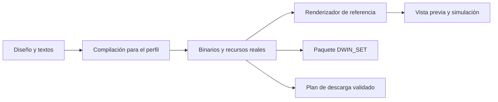

# Migración de V7.651: compatibilidad, vista previa y generación integrada

> Documento de investigación. El plan de trabajo vigente, más simple, está en [PLAN.md](PLAN.md); allí el «perfil de destino» se reduce a un único JSON por pantalla.

Fecha de investigación: 18 de noviembre de 2026.

La migración es viable con un motor DGUS II común y perfiles de destino verificables. El resultado buscado es elegir una pantalla, diseñar, comprobar el resultado y pulsar «Generar para pantalla». Las tareas de creación de fuentes, empaquetado de imágenes y asignación de archivos deben quedar integradas en esa operación.

Esto es una propuesta técnica apoyada en el código actual, los archivos de V7.651 y documentación oficial. No es una certificación del hardware ni una implementación ya terminada. El [informe de código](../docs/ANALISIS_2026-11-18.md) detalla los fallos que hay que corregir durante la migración.

**El alcance solicitado**

El editor debe mantener las funciones de DGUS V7.651 y producir archivos compatibles con los modelos DWIN que utiliza esa herramienta. La experiencia de uso puede simplificarse sin cambiar el significado de las variables, controles o recursos que recibe la pantalla.

DWIN sitúa [DGUS_V7651 en la categoría T5L DGUS](https://www.dwin-global.com/tool-page/). La misma página presenta por separado TA, Linux y Android. El criterio de inclusión debe ser que el modelo y su firmware acepten el entorno de archivos DGUS II que genera V7.651. El nombre de la marca, el tamaño o incluso la presencia de un chip T5L no bastan para determinarlo.

La [guía TA, sección 2.1](https://ecdn6.globalso.com/upload/p/1355/source/2024-11/T5L_TA-Development-GuideV3.pdf#page=5), muestra que un T5L puede usar DGUS II o TA según el firmware. El catálogo y el perfil del proyecto deben reflejar ese modo real.

Los modelos nuevos que conserven los formatos y las capacidades conocidas podrán incorporarse mediante un perfil, sin rehacer el editor. Una extensión nueva del firmware necesitará documentar sus diferencias y validarlas. Esta es la forma de ampliar la cobertura manteniendo compatibilidad, sin declarar comprobadas pantallas futuras que aún no se han evaluado.

**Qué encontré en el selector de la instalación**

Hay dos conjuntos distintos de datos en el V7.651 local:

| Archivo | Contenido comprobado | Uso propuesto |
|---|---|---|
| [Config/Terminal.ini:12](<carpeta-de-DGUS-V7.651>/Config/Terminal.ini:12) | 31 opciones de resolución, con 30 valores distintos porque `800X600` aparece dos veces | Compatibilidad con los tamaños que ofrece el editor original |
| [TOOL/settings.ini:5](<carpeta-de-DGUS-V7.651>/TOOL/settings.ini:5) | 26 plantillas de panel con secuencias de configuración | Referencia histórica para identificar parámetros; requieren contraste antes de usarlas |
| [TOOL/SystemConfig.ini:1](<carpeta-de-DGUS-V7.651>/TOOL/SystemConfig.ini:1) | Otro listado de 23 resoluciones para herramientas auxiliares | Revisar qué herramienta consume cada listado |
| [Language/English.ini:69](<carpeta-de-DGUS-V7.651>/Language/English.ini:69) | Menús y funciones del editor original | Inventario funcional de la migración |
| [version.cfg](<carpeta-de-DGUS-V7.651>/version.cfg) | Historial de cambios hasta V7.651 | Seguimiento de capacidades y correcciones del producto original |

El primer listado contiene `480X854`, `854X480`, `480X800`, `1920X1080` y otros tamaños. Sus entradas no son códigos comerciales del tipo `DMG...`. Estos archivos permiten recuperar las opciones del programa, pero no identificar qué pantalla física está conectada ni certificar un conjunto de modelos por sí solos.

Las 30 resoluciones distintas del selector principal, conservando sus valores originales, son:

```text
320x160    480x272    480x854    854x480    800x600
512x480    512x300    400x400    640x512    1024x768
850x600    854x600    1024x600   600x1024   272x480
320x240    240x320    480x400    600x800    1364x768
800x480    480x480    768x1024   480x320    1280x760
720x1280   720x720    480x800    1920x1080  1280x800
```

Conservar esos valores no implica que todas las etiquetas sean fichas de hardware correctas. Por ejemplo, la plantilla `640*480` de `settings.ini` contiene `02 58` en los bytes que corresponderían al ancho del panel según la disposición del CFG, equivalente a 600. Debe contrastarse su uso antes de trasladarla a una configuración automática. Tampoco conviene corregir de oficio nombres como `1280x760` sin conocer el proyecto y el destino.

El historial original reconoce correcciones relacionadas con el problema descrito: V7.637 menciona posición de variables centradas, y V7.638 menciona diferencias de tamaño entre texto chino y números en la vista previa. Esto confirma que el propio producto tuvo discrepancias de representación; no identifica todavía la causa del proyecto concreto del usuario.

**Lo que aportan los manuales y las fichas**

Consulté la guía DGUS II publicada en el portal oficial, 239 páginas, cuya portada dice versión 2.9 aunque el nombre descargado termina en `V2.921`. También revisé la guía COF, el documento ASIC enlazado por DWIN y fichas representativas de módulos estándar, COF y 2K. Los nombres y fechas de los enlaces no siempre coinciden con las revisiones que figuran dentro de los documentos; el perfil debe registrar ambas referencias.

| Referencia | Hecho útil para la migración | Consecuencia de diseño propuesta |
|---|---|---|
| [Guía DGUS II, secciones 7.12, 7.13 y 7.18](https://ecdn6.globalso.com/upload/p/1355/source/2026-03/T5L_DGUSII-Application-Development-Guide-V2.921.pdf#page=152) | Los controles numéricos, el texto de matriz y el texto DGUS II tienen parámetros de tamaño diferentes | El editor debe traducir un tamaño visual a la representación propia de cada control |
| [Guía DGUS II, sección 3.3](https://ecdn6.globalso.com/upload/p/1355/source/2026-03/T5L_DGUSII-Application-Development-Guide-V2.921.pdf#page=23) | El paquete puede incluir configuración, fuentes y recursos además de 13/14/22 | Validar las dependencias completas al generar |
| [Guía COF, secciones 3 y 5](https://ecdn6.globalso.com/upload/p/1355/source/2024-11/COF-Screen-Application-DevelopmentT5L_DGUSII20220610.pdf) | Describe particularidades de funciones y archivos para esa plataforma | Mantener capacidades por versión en lugar de copiar todas las reglas de la guía general |
| [Fichas DMG80480C070_04W](https://ecdn6.globalso.com/upload/p/1355/source/2025-09/Datasheet-DMG80480C070_04W1.zip) | Variantes T5L0, DGUS II, 800x480 y 16 MB de flash | Mismo tamaño de lienzo con distintas opciones de toque |
| [Fichas DMG48480F021_01W](https://ecdn6.globalso.com/upload/p/1355/source/2025-09/Datasheet-DMG48480F021_01W2.zip) | Módulos COF T5L0, 480x480, circulares, con 8 MB de flash | El perfil necesita memoria y máscara visible de pantalla |
| [Ficha DMG19108C156_05WTC](https://ecdn6.globalso.com/upload/p/1355/source/2025-09/DMG19108C156_05WTC4.pdf) | Plataforma 2K DGUS II, 1920x1080 y 32 MB, con opciones de expansión | Separar los perfiles 2K y su mapa de recursos |
| [Firmware oficial](https://www.dwin-global.com/kernel-upgrade/) | DWIN separa COB, COF, 2K y variantes OS con y sin respuesta a escrituras | El protocolo y las funciones deben depender del firmware seleccionado |

Estas fichas son muestras de las diferencias que habrá que cubrir. No constituyen un catálogo exhaustivo ni prueban que todas sus revisiones funcionen ya con T5L Studio.

Una diferencia que requiere atención es el texto DGUS II: la guía COF de 2022 describe ese control sin soporte de escalado, mientras la guía general consultada documenta un factor de escala. No se debe convertir esto en una regla para todos los COF actuales. La capacidad debe asociarse al firmware y comprobarse, porque asumir escala disponible podría producir precisamente una discrepancia de tamaño.

**El problema de los textos y la situación del código actual**

La observación del usuario es que el simulador de V7.651 se ve bien, pero el texto cargado aparece más grande y desplazado. Sin una pantalla identificada y una comparación del proyecto concreto, no es posible atribuir esa diferencia a una única causa. Sí se puede evitar reproducir el mismo problema en la migración.

En T5L Studio confirmé estas diferencias entre la previsualización y los datos que se exportan:

| Situación | Evidencia en el código | Efecto |
|---|---|---|
| `textII` con escala 100 % y 200 % | [display.ts:585](../src/core/controls/display.ts:585) calcula la vista previa a partir del alto del rectángulo | Ambas vistas previas indican 26 px, aunque los bytes exportados cambian de `0x10` a `0x20` |
| Texto sin una fuente real dibujada | [ControlView.tsx:258](../src/ui/components/ControlView.tsx:258) usa un tamaño CSS limitado por el alto disponible | La vista puede encoger el texto para que quepa; el archivo exportado conserva otro tamaño |
| Texto de matriz y texto DGUS II | La ruta de dibujo con biblioteca ASCII real solo se aplica a variables numéricas, RTC y HEX | Para otros textos se usa una representación que no lee sus glifos exportados |
| Espaciado y alineación vertical | Se codifican campos que no participan de forma equivalente en la vista previa | La posición aparente puede diferir del resultado de la pantalla |
| Sustitución de una fuente | La caché no identifica todo el contenido del recurso | Puede seguir mostrándose una fuente anterior, como detalla el informe de código |

El caso de 100 % frente a 200 % se ejecutó directamente contra los módulos actuales. No depende de una apreciación visual:

```json
{"fontHeight":100,"preview":{"text":"Texto","fontPx":26},"exportedScaleByte":16}
{"fontHeight":200,"preview":{"text":"Texto","fontPx":26},"exportedScaleByte":32}
```

La solución propuesta es generar primero los recursos reales y dibujar la vista fiel a partir de ellos. El renderizador recibirá el bloque de control ya compilado, los archivos de fuentes e imágenes, la memoria VP y el perfil de destino. Así podrá interpretar los mismos parámetros que se enviarán al dispositivo.



El zoom del editor debe ampliar la imagen resultante, sin cambiar el tamaño lógico de los glifos. Si un texto se sale del área, la vista fiel mostrará el recorte y el editor indicará el desbordamiento. Ajustar automáticamente el CSS para que parezca caber ocultaría el problema que se quiere resolver.

La interfaz puede ofrecer controles familiares, como tamaño en píxeles, alineación y espacio entre líneas. El programa traducirá esas elecciones a los tamaños admitidos por la biblioteca y a la escala efectiva del firmware. Cuando exista cuantización, deberá mostrar el tamaño que realmente se generará.

Para una tipografía de Windows o un TTF/OTF, se generará una biblioteca compatible y se usará esa misma biblioteca en la vista previa. El usuario debe ver si faltan caracteres como `ñ`, `°`, `µ` o signos propios de su aplicación. La generación deberá añadirlos al recurso adecuado o explicar qué opción compatible resuelve el problema.

Los textos que permanecen fijos pueden componerse automáticamente en el fondo como una optimización del editor. Los textos que dependen de VP, cambian de idioma, se desplazan o son modificados por el MCU deben conservar su comportamiento de control. Esta decisión debe basarse en la función del objeto y mantenerse visible en sus propiedades.

**Cómo funcionaría «Generar para pantalla»**

El usuario seleccionará una vez el destino y la carpeta de salida. Para uso cotidiano, un botón ejecutará la generación completa:

1. Guardar una revisión concreta del diseño y resolver sus dependencias.
2. Comprobar las funciones del perfil, las referencias de páginas y los intervalos de VP y SP.
3. Crear o reutilizar las bibliotecas de fuentes requeridas por los textos y variables.
4. Componer fondos e iconos, convertirlos al formato admitido y empaquetar los ICL.
5. Asignar espacio a recursos nuevos sin colisiones. Los IDs importados o usados por el firmware del usuario se mantendrán estables salvo una migración explícita.
6. Generar 13, 14 y 22, junto con los recursos adicionales que utiliza el proyecto.
7. Preparar el CFG a partir de una plantilla validada para el destino o de una configuración importada. Los tiempos del panel y parámetros táctiles de fábrica se conservarán salvo un cambio específico verificado.
8. Volver a leer los archivos generados y comprobar su estructura, límites y dependencias.
9. Escribir un paquete completo en una carpeta de preparación y publicar el resultado como `DWIN_SET` mediante una operación segura.

La salida deberá informar «Listo para copiar» o mostrar un error que lleve al objeto que requiere corrección. El flujo normal no debe pedir abrir generadores externos, editar direcciones hexadecimales o volver a ejecutar varias herramientas.

El botón puede tener como destino guardado una carpeta del disco o de una tarjeta. Crear los archivos no sustituye la secuencia física de carga que requiera la pantalla. Para UART habrá una acción de descarga que comparta exactamente el mismo paquete compilado, con progreso y posibilidad de cancelar según el protocolo.

Los archivos de firmware, los programas del usuario y otras extensiones conservarán su procedencia y su relación con el perfil. Actualizar el editor no debe convertir implícitamente un proyecto antiguo a un firmware distinto.

**Perfiles de destino y cobertura**

Propongo separar tres identidades que hoy se mezclan:

| Identidad | Qué determina |
|---|---|
| Perfil de hardware | Modelo comercial, resolución nativa, máscara visible, toque y memoria instalada |
| Perfil de firmware | Modo DGUS II, revisiones UI/OS y capacidades concretas |
| Perfil del proyecto | Orientación, asignación de recursos, bibliotecas y opciones de generación |

El chip sirve para seleccionar una familia de reglas, pero no reemplaza los datos de la ficha del módulo y su firmware. El catálogo debe poder representar módulos estándar T5L0/T5L1/T5L2, COF y 2K dentro del alcance DGUS II. Las pantallas con funciones de cámara, vídeo u otras extensiones necesitarán capacidades y pruebas propias.

La investigación también encontró [T5F0 DGUS II Application Guide, Ver. 6.5, página 4 del PDF](https://ecdn6.globalso.com/upload/p/1355/source/2025-11/T5F0-DGUSII-Application-Guide-Ver.-6.5.pdf#page=4). DWIN describe compatibilidad de proyectos T5L con T5F0 si se atienden las diferencias; entre ellas figuran límites de resolución, JPEG y memoria. Esto no certifica toda la familia contra V7.651, pero obliga a tratarla como candidata a verificación, sin excluirla solamente por su nombre de chip. La regla final seguirá siendo la compatibilidad comprobada con los proyectos y funciones del entorno solicitado.

Cada capacidad debe indicar si está documentada, validada con archivos, probada físicamente o todavía desconocida. Los campos desconocidos no deben convertirse en valores por defecto que parezcan certificados.

Una estructura posible para el catálogo, todavía propuesta, es:

```typescript
interface TargetProfile {
  id: string;
  model: string;
  projectFormat: 'DGUS-II-13-14-22';
  chip: string;
  architectureProfile: string;
  structure: 'COB' | 'COF';
  nativeResolution: { width: number; height: number };
  visibleShape: 'rectangle' | 'circle' | 'custom';
  flashMap: string;
  firmwareProfile: string;
  verifiedCfgTemplate?: string;
  sources: { url: string; revision?: string; pages?: string }[];
  verification: 'documented' | 'files-tested' | 'hardware-tested';
}
```

Los límites de texto, tamaños de imágenes, distribución de flash, escalado, respuestas serie y comandos disponibles pertenecerán a las capacidades referenciadas por ese perfil. Es necesario contemplar los mapas que cambian con el tipo de memoria; el `SECTOR = 256 * 1024` actual no debe convertirse en una suposición universal para todas las expansiones.

La lectura de la versión del dispositivo puede ayudar a seleccionar un perfil. Debe presentarse como detección parcial si el protocolo no identifica de forma inequívoca el modelo. Un archivo `T5LCFG` tampoco es por sí solo una ficha comercial completa.

**Conservar todas las funciones requiere una matriz de paridad**

Tener 48 entradas en la caja de herramientas no demuestra la migración completa. Hay que comparar las funciones reales de V7.651 y registrar generación, edición, importación y simulación por separado.

| Área | Situación actual observada | Trabajo necesario |
|---|---|---|
| Controles básicos y generación 13/14/22 | Implementados, con fallos de límites e inicialización | Corregir las regresiones y ampliar referencias binarias |
| Importación de controles | 7 tipos vuelven como bloque original | Añadir edición semántica o bloquear propiedades que no afectan a la salida |
| Fuentes | Hay generadores y lectura parcial para previsualización | Integrar generación, métricas y representación fiel |
| Teclados y rodillos UIC | Herramientas presentes en la distribución original; integración nueva incompleta | Incorporar asistentes y todos sus recursos al proyecto |
| Multilenguaje | V7.651 incorpora herramientas dedicadas; un control de icono no cubre todo ese flujo | Inventariar textos, bibliotecas, IDs y conmutación de idiomas |
| Audio, vídeo y cámara | Existen controles y herramientas auxiliares originales | Verificar formatos, generación de recursos y capacidades por destino |
| Configuración de red y valores de sistema | Hay funciones originales que escriben configuración | Mantener sus datos y comprobar su interfaz de edición |
| Edición avanzada | El original ofrece operaciones como arrays y cambios por lotes | Contrastar cada operación con la nueva interfaz |
| Simulación | Implementa comportamientos parciales | Compartir memoria, reglas y representación con la salida compilada |
| Importación del proyecto de edición original | Se importa el paquete de pantalla | Recuperar también metadatos editables sin ejecutar deserialización insegura |

Un proyecto importado sin cambios debería conservar sus archivos y recursos originales cuando no existe una conversión necesaria. Los proyectos nuevos pueden producir archivos optimizados con otros bytes, siempre que cumplan el formato y mantengan el comportamiento. La igualdad byte a byte y la equivalencia funcional son comprobaciones complementarias.

**Plan de ejecución y aceptación**

1. Estabilizar el núcleo y la preservación del trabajo. Incorporar los casos reproducidos del informe y comprobar que un fallo de validación impide generar un paquete presentado como válido.
2. Extraer los presets heredados a un catálogo con procedencia y crear la matriz de capacidades. Empezar las pruebas con el tamaño 480x854 de las muestras existentes, manteniendo todas las demás resoluciones en el alcance.
3. Construir el renderizador de referencia para texto numérico, texto de matriz y texto DGUS II. Validar alturas, anchos, anclajes, espaciado, recorte y glifos faltantes con recursos reales.
4. Integrar fuentes, imágenes, CFG y binarios en una sola compilación. Probar un proyecto nuevo en una pantalla sin depender de los recursos que hubiera cargados anteriormente.
5. Completar la matriz de paridad del editor original y la importación. Cada control necesitará casos de generación, importación y comportamiento, incluyendo sus límites.
6. Validar por familias y revisiones de firmware con equipos físicos. Registrar el perfil, el paquete exacto y los resultados de texto, toque y protocolo antes de etiquetar el destino como probado.

Para la fidelidad de texto, la aceptación debe comparar posiciones y dimensiones en píxeles de la representación compilada y del resultado del equipo. La apariencia de una tipografía del sistema en el navegador no sirve como referencia independiente. Cuando exista captura compatible en el dispositivo, podrá automatizarse parte de la comparación; las demás pruebas requerirán una captura controlada del panel.

Para el botón único, la aceptación es que un proyecto completo produzca todos sus archivos necesarios sin utilidades externas ni retoques manuales; repetir la generación sin cambios debe conservar el resultado. Cambiar el proyecto debe invalidar cualquier plan de descarga anterior.

El primer bloque de desarrollo debería centrarse en texto fiel, catálogo de destino y compilación integrada. Es el trabajo que resuelve directamente la discrepancia visual y elimina los pasos manuales sin perder el alcance funcional de V7.651.
